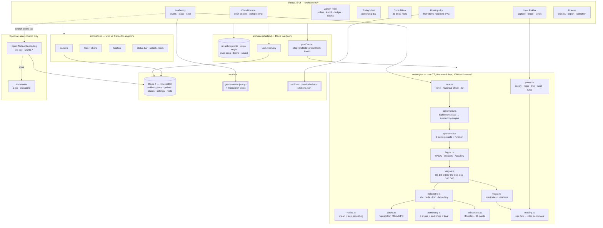

# Chowki (Jyoti) — Architecture

Written 2026-09-08. Binding alongside `GOAL.md`, `docs/DESIGN.md` and `../_shared/DECISIONS.md` (this project is §D8 row 02). Every version below is the one verified in `docs/RESEARCH.md` on 2026-09-06; pin them in `package.json`.

The whole product is a pure function plus a face: `(birth date, time, place) → Patri`, `(photo) → palm reading`. Nothing needs a server, a key or an account. The engine is written first, framework-free, and unit-tested against golden fixtures before any pixel is drawn (DECISIONS §D9.2).

---

## 1. Stack

| Layer | Choice | Version (verified 2026-09-06) | Why for Chowki |
|---|---|---|---|
| Build | Vite | 8.2.2 (MIT) | One static `dist/` serves GitHub Pages and the Capacitor APK; `base` parameterised per target |
| UI | React 19 + TypeScript (strict) | react 19.2.8 (MIT) | D1; the whole desk is DOM/CSS/SVG, so React's reconciliation is the only runtime cost |
| Styling | Tailwind CSS v4 (`@tailwindcss/vite`) + `src/styles/tokens.css` | 4.3.3 (MIT) | D7 token names with DESIGN §15 values; hand-written CSS for paper, brass, lac, grain, lamp shadows |
| Motion | Motion (`motion/react`) | 13.2.0 (MIT) | `pathLength` ink-draw, four material springs, `drag` for drums/loupe/stylus, `useScroll` for the unroll. **GSAP is not used** — DrawSVG's only job here is covered by `pathLength`, and GSAP is not OSI (DESIGN §3) |
| Route transitions | View Transitions API (native) + React Router 7 `createHashRouter` | 7.x (MIT) | `object-open` carries the tapped desk object into its screen; hash routing deep-links on Pages with no rewrite |
| Persisted data | Dexie + dexie-react-hooks + dexie-export-import | 4.4.5 / 4.4.0 / 4.4.0 (Apache-2.0) | Profiles, cached Patris, palm Blobs; `liveQuery` for the leaf bundle; streaming export feeds the encryption envelope |
| UI state | Zustand | 5.0.15 (MIT) | Active profile, open drawer, loupe target, drum drag, sound/haptics, theme override |
| Ephemeris | `astronomy-engine` | 2.1.19 (MIT) | ±1′ vs NOVAS; `Ecliptic(GeoVector(b,t,true))` is true-ecliptic-of-date, the same convention Swiss Ephemeris uses. Frozen upstream (no release since 2023-12-14) — pinned and vendored if it ever disappears |
| Vedic math | **own `src/engine/`** (ayanamsa, node, lagna, vargas, dasha, panchang, yogas, ashtakoota, palm rules) | — (MIT, ours) | Auditable, unit-testable, citation-carrying; the reason the app exists |
| Panchang cross-check | `@ishubhamx/panchangam-js` | 3.0.0 (MIT) | MVP accelerator and a permanent second opinion in tests. CJS with one `require("fs")` — stubbed in `vite.config.ts` |
| Time zones | `@photostructure/tz-lookup` + `luxon` | 11.6.1 (CC0-1.0) / 3.7.2 (MIT) | lat/lon → IANA zone in 88 kB; Luxon reads the browser's tzdb for historical offsets (+06:30 war time, +05:21:10 MMT). Temporal is not in Safari, so Luxon stays |
| Gazetteer | GeoNames `cities500` subset + `minisearch` | dump (CC BY 4.0) / 7.2.0 (MIT) | Offline birthplace search; ≤ 1.8 MB gz (the budget `build-gazetteer.mjs` asserts — §11), precached |
| Hand landmarks | `@mediapipe/tasks-vision` + `hand_landmarker.task` | 1.0.1 (Apache-2.0) / model 7.46 MiB (Apache-2.0) | 21 landmarks + handedness, IMAGE mode, self-hosted wasm for offline |
| Palm-line CV | `@techstark/opencv-js` pinned `4.12.0-release.1` | 4.12.0-release.1 (Apache-2.0) | CLAHE, black-hat, Sobel/Hessian, warpPerspective, connectedComponents. 14.7 MB unpacked → lazy chunk on the Hast screen only; `ximgproc.thinning` is absent, so Zhang-Suen is ours (§5.13) |
| Sky | `three` + `@react-three/fiber` + `@react-three/drei`; `d3-geo` for the 2D fallback and the parapet strip | 0.185.1 / 9.7.0 / 10.7.8 / 3.x (MIT) | Rooftop dome with BSC5 stars; lazy chunk, `frameloop="demand"`, painted-SVG fallback |
| Sound | `howler` + CC0 sprite | 2.2.x (MIT) | One sprite ≤ 300 kB (DESIGN §12); no tanpura, no music |
| Primitives | shadcn/ui on Base UI (Dialog, RadioGroup, Switch, Tabs) | via `npx shadcn@latest` (MIT) | Focus trap, `role="dialog"`, Esc — restyled through tokens, never forked |
| Icons | `lucide-react` | 1.41.0 (ISC) | 16 px, inside paper content only |
| Fonts | `@fontsource/yatra-one`, `@fontsource/tiro-devanagari-hindi`, `@fontsource-variable/martian-mono` | 5.3.x (OFL 1.1) | DESIGN §5; subset to Latin + Latin-1 + Devanagari + `°′″℞`, ≤ 260 kB woff2 total |
| PWA | `vite-plugin-pwa` (Workbox) + `@vite-pwa/assets-generator` | 1.3.0 / 1.0.2 (MIT) | Precache shell/fonts/gazetteer/sounds; runtime cache for models, OpenCV and the sky chunk |
| Android shell | `@capacitor/core`, `/android`, `/cli` | 8.5.1 (MIT) | Same `dist/`; built in CI with Temurin 21, AGP 8.13, Gradle 8.14.3, compileSdk 36, minSdk 24 |
| Android plugins | `@capacitor/camera` 8.2.4, `/filesystem` 8.1.3, `/preferences` 8.0.1, `/haptics` 8.0.2, `/share` 8.0.1, `/app` 8.1.1, `/status-bar` 8.0.3, `/splash-screen` 8.0.2 | MIT | Palm capture, encrypted export, detent haptics, edge-to-edge, predictive back |
| Tests | Vitest + Testing Library; Playwright (e2e + screenshots) | latest | Golden charts, the 11,664-pair Ashtakoota oracle, the screenshot contract vs `design/preview.html` |
| Lint/format | Biome | latest | One tool (D1) |
| Hosting / CI | GitHub Pages + Actions + Releases | free | D2/D3; **no Cloudflare Worker** — no secret exists anywhere in this app |

**Deviations from DECISIONS.md, justified.**

- **No `src/wit/`** and no LLM rung at all. D4's wit ladder exists for apps whose text is a joke; Chowki's text is a *citation*. Readings are deterministic sentences composed from rule hits (§5.15). A BYO-key paraphraser is a Someday item (GOAL §7) and would be labelled as a paraphrase of the rule hits, never as the reading.
- **No `worker/`** — nothing needs a hidden key, so no Cloudflare Worker exists (D2's "when a secret exists" clause never fires).
- **GSAP is not a dependency** even though D1 permits it; Motion's `pathLength` is the entire ink-draw requirement and staying OSI-clean is worth more than DrawSVG's convenience.
- **Swiss Ephemeris stays out of `package.json`.** The `Ephemeris` interface (§5.3) has a second implementation sketched for the AGPL lane, but installing it requires relicensing the repo (D5.1), so it is a documented option, not a dependency.

---

## 2. System diagram



In one sentence: the UI reads profiles through `useLiveQuery`, asks `engine/` for a `Patri` (a pure function of a `BirthMoment` plus an `EnginePreset`), memoises the result in `patriCache` and writes it to Dexie so a revisit never recomputes; palm photos travel photo → landmarks → rectified ROI → line paths → the same `reading.ts` that yogas use; the only outbound request in the entire app is a place search the owner explicitly tapped.

---

## 3. Folder layout (future repo `jyoti/`)

Follows DECISIONS §D6, with `src/wit/` and `worker/` absent for the reasons in §1.

```
jyoti/
├── .github/workflows/
│   ├── pages.yml                  # copied from _shared/templates/pages.yml
│   └── android-release.yml        # copied from _shared/templates/android-release.yml
├── android/                       # Capacitor shell, committed (generated by `npx cap add android`)
├── public/
│   ├── grain.svg                  # baked feTurbulence paper tile (<6 kB)
│   ├── seal-edge.svg              # pre-displaced lac seal + tilak edges (no live filters)
│   ├── models/hand_landmarker.task
│   ├── mediapipe/                 # tasks-vision wasm, self-hosted
│   ├── sounds/chowki.{webm,mp3}   # one CC0 sprite + ATTRIBUTION.md
│   └── icons/                     # PWA 192/512 + maskable, adaptive icon sources
├── scripts/
│   ├── build-gazetteer.mjs        # GeoNames dump -> src/data/geonames-in.json.gz
│   ├── build-stars.mjs            # BSC5 -> src/data/bsc5.bin (Float32 RA/Dec/mag)
│   └── subset-fonts.sh            # pyftsubset: Latin + Devanagari + °′″℞
├── src/
│   ├── app/
│   │   ├── router.tsx             # createHashRouter, the 12 routes of DESIGN §9
│   │   ├── Shell.tsx              # desk, Ledge, lamp, vignette, view-transition names
│   │   └── providers.tsx          # MotionConfig, theme bootstrap, error boundary
│   ├── features/
│   │   ├── chowki/                # home desk, DeskObject, ParapetSky
│   │   ├── leaf/                  # BrassDrum, PlaceSearch, EngravedStrip, SealButton
│   │   ├── patri/                 # Roller, KundliNorth/South, GrahaLedger, DashaRibbon, Loupe
│   │   ├── today/                 # BrassDial, LedgerRow, MoonPager
│   │   ├── milan/                 # ScrollPair, BeadRow, LacBandStamp
│   │   ├── hast/                  # CameraView, QualityGauge, PalmPrint, LineOverlay, StylusEditor
│   │   ├── sky/                   # SkyDome (lazy), PaintedSky, ScrubRing, PosterAction
│   │   └── drawer/                # DialSegment presets, export/import, Colophon
│   ├── engine/                    # pure domain logic — no React, no DOM (except palm/cv.ts)
│   │   ├── time.ts  ayanamsa.ts  ephemeris.ts  nodes.ts  lagna.ts
│   │   ├── vargas.ts  nakshatra.ts  dasha.ts  panchang.ts
│   │   ├── yogas.ts  ashtakoota.ts  reading.ts  patri.ts
│   │   ├── palm/  rectify.ts  enhance.ts  ridge.ts  thin.ts  label.ts  shape.ts  rules.ts
│   │   ├── sky/   stars.ts  horizon.ts
│   │   └── __fixtures__/          # golden charts, Drik screenshots' numbers, ashtakoota CSV
│   ├── data/
│   │   ├── db.ts  repo.ts  crypto.ts        # Dexie schema, transactions, AES-GCM envelope
│   │   ├── geonames-in.json.gz  places.ts   # gazetteer + minisearch + online fallback
│   │   ├── tables/                          # nakshatras, signs, lords, yoni, gana, vashya, vargas
│   │   ├── citations.json                   # BPHS/Muhurta Chintamani chapter-verse map
│   │   ├── bsc5.bin
│   │   └── attribution.json
│   ├── components/ui/             # shadcn on Base UI, restyled: Drawer, FootnoteSheet, RadioRow…
│   ├── motion/springs.ts          # PAPER · BRASS · THREAD · INK (DESIGN §7)
│   ├── styles/tokens.css          # DESIGN §15, pasted verbatim
│   └── platform/                  # camera.ts files.ts haptics.ts bars.ts (web | capacitor)
├── e2e/                           # Playwright flows + screenshot baselines
├── docs/                          # GOAL/RESEARCH/DESIGN/ARCHITECTURE/PLAN/TESTING
└── design/preview.html            # the visual contract
```

---

## 4. Data model

All types live in `src/engine/types.ts` (domain) and `src/data/db.ts` (persisted). Angles are **degrees**, always normalised to `[0, 360)`; times are stored as UTC epoch milliseconds plus the resolved zone, never as local strings.

```ts
// ─── identity & storage ──────────────────────────────────────────────────────
export type ProfileId = string;   // crypto.randomUUID()
export type Deg = number;         // 0 <= d < 360
export type Jd  = number;         // Julian Day, UT unless the field says TT

export interface Place {
  name: string;            // "Bengaluru"
  admin1?: string;         // "Karnataka"
  country: string;         // ISO-3166 alpha-2, "IN"
  lat: number;             // +N
  lon: number;             // +E
  elevation?: number;      // metres, optional; unused by the engine, shown in the colophon
  geonameId?: number;      // present when it came from the bundle
  source: 'bundle' | 'open-meteo' | 'nominatim' | 'manual';
}

export interface BirthMoment {
  localY: number; localMo: number; localD: number;   // as written on the leaf
  localH: number; localMi: number;                    // 24h, local clock at the place
  place: Place;
  zone: string;                    // IANA, e.g. "Asia/Kolkata" (from tz-lookup, editable)
  offsetOverrideMin?: number;      // e.g. 291 for Bombay Time +04:51; wins over the tzdb
  utcMs: number;                   // resolved instant — the single source of truth
  offsetMin: number;               // the offset actually used, minutes east of UTC
  jdUt: Jd;                        // utcMs -> JD_UT
  offsetSource: 'tzdb' | 'override';
}

export interface Profile {
  id: ProfileId;
  name: string;
  birth: BirthMoment;
  handedness: 'right' | 'left';    // dominant hand, for the palm framing
  gender?: 'a' | 'b';              // only used to label the two sides of a Milan; never a rule input
  createdAt: number; updatedAt: number;
}

// ─── engine configuration (part of every cache key) ──────────────────────────
export type AyanamsaPreset = 'se-true' | 'se-mean' | 'drik-mean';
export type NodeMode       = 'true' | 'mean';
export type SunriseMode    = 'upper-limb-refracted' | 'disc-centre';
export interface EnginePreset {
  ayanamsa: AyanamsaPreset;        // default 'se-true'
  node: NodeMode;                  // default 'true'
  dashaYearDays: 365.25 | 360;     // default 365.25
  sunrise: SunriseMode;            // default 'upper-limb-refracted'
  houseSystem: 'whole-sign' | 'bhava-chalit';  // chart is always whole-sign; this drives yogas
}
export const PRESET_HASH = (p: EnginePreset) => `${p.ayanamsa}|${p.node}|${p.dashaYearDays}|${p.sunrise}|${p.houseSystem}`;

// ─── the chart ───────────────────────────────────────────────────────────────
export type GrahaId = 'SU'|'MO'|'MA'|'ME'|'JU'|'VE'|'SA'|'RA'|'KE';
export type SignIdx = 0|1|2|3|4|5|6|7|8|9|10|11;   // 0 = Mesha (Aries)

export interface Graha {
  id: GrahaId;
  lonTropical: Deg;        // apparent, true ecliptic of date
  lonSidereal: Deg;
  speed: number;           // deg/day, sidereal; negative = retrograde
  retrograde: boolean;
  sign: SignIdx;
  degInSign: number;       // 0..30
  nakshatra: number;       // 0..26, Ashwini = 0
  pada: 1|2|3|4;
  nakshatraLord: GrahaId;
  house: number;           // 1..12, whole-sign from the Lagna
  dignity: 'exalted'|'moolatrikona'|'own'|'friend'|'neutral'|'enemy'|'debilitated';
  combust: boolean;
  boundary: BoundaryFlag | null;   // set when within 2' of a sign/nakshatra/pada edge
}

export interface BoundaryFlag {
  kind: 'sign' | 'nakshatra' | 'pada';
  arcminutesTo: number;    // distance to the nearest edge, in arcminutes
  otherSide: string;       // "Jyeṣṭhā" — what a neighbouring preset would read
}

export interface VargaChart {
  varga: 1|2|3|7|9|10|12|30|60;
  ascendantSign: SignIdx;
  placements: Record<GrahaId, SignIdx>;
}

export interface DashaNode {
  lord: GrahaId;
  startMs: number; endMs: number;
  level: 1|2|3;            // maha / antar / pratyantar
  children?: DashaNode[];  // level 3 is generated lazily
}

export interface Panchang {
  tithi: { index: number; name: string; paksha: 'shukla'|'krishna'; endMs: number };
  vara: { index: 0|1|2|3|4|5|6; name: string };          // 0 = Ravivāra
  nakshatra: { index: number; name: string; endMs: number };
  yoga: { index: number; name: string; endMs: number };
  karana: { index: number; name: string; endMs: number };
  sunriseMs: number; sunsetMs: number; moonriseMs: number | null; moonsetMs: number | null;
  rahuKaal: [number, number]; yamaganda: [number, number]; gulika: [number, number];
  abhijit: [number, number] | null;                      // absent on Wednesdays by convention
  masaAmanta: string; masaPurnimanta: string; ritu: string; ayana: 'uttarayana'|'dakshinayana';
  moonIllumination: number;                              // 0..1, drives --moon-k (DESIGN §4.2)
}

export interface Citation { text: string; ref: string; }  // { "BPHS", "36.13" }

export interface YogaHit {
  id: string;                    // 'gaja-kesari'
  name: string; nameDev: string;
  strength: 'full' | 'partial' | 'cancelled';
  because: Array<{ grahaId?: GrahaId; house?: number; sign?: SignIdx; note: string }>;
  citation: Citation;
  cancelledBy?: string;          // id of the cancelling rule, when strength === 'cancelled'
}

export interface Patri {
  profileId: ProfileId;
  preset: EnginePreset; presetHash: string;
  engine: { name: 'astronomy-engine'; version: string; ayanamsaArcsec: number };
  jdUt: Jd; jdTt: Jd; ayanamsa: Deg;
  lagna: { lonTropical: Deg; lonSidereal: Deg; sign: SignIdx; degInSign: number;
           nakshatra: number; pada: 1|2|3|4; boundary: BoundaryFlag | null };
  mc: { lonSidereal: Deg; sign: SignIdx };
  grahas: Record<GrahaId, Graha>;
  vargas: Record<number, VargaChart>;      // keyed by varga number; D1 and D9 always present
  dasha: DashaNode[];                      // 9 maha-dashas, antars filled, pratyantars lazy
  birthPanchang: Panchang;
  yogas: YogaHit[];
  computedAt: number; computeMs: number;   // performance budget evidence, shown in the colophon
}

// ─── matching ────────────────────────────────────────────────────────────────
export type KootaId = 'varna'|'vashya'|'tara'|'yoni'|'maitri'|'gana'|'bhakoot'|'nadi';
export interface KootaResult {
  id: KootaId; nameDev: string; max: 1|2|3|4|5|6|7|8;
  score: number;                 // may be 0.5 / 1.5
  dosha: boolean;
  because: string;               // "Nadi: both Madhya" — shown under the bead group
  cancellation?: { applied: boolean; rule: string; citation: Citation };
  citation: Citation;
}
export interface MilanResult {
  a: ProfileId; b: ProfileId; presetHash: string;
  kootas: KootaResult[];         // always 8, in bead order
  total: number;                 // 0..36
  band: 'not-recommended'|'acceptable'|'very-good'|'excellent';
  manglik: { a: ManglikStatus; b: ManglikStatus };
  porutham?: Array<{ id: string; pass: boolean; note: string }>;   // v1, South-Indian 10
}
export interface ManglikStatus {
  present: boolean;
  from: Array<'lagna'|'moon'|'venus'>;
  cancellations: string[];       // rule ids that cancel it
  citation: Citation;
}

// ─── palmistry ───────────────────────────────────────────────────────────────
export interface Landmark { x: number; y: number; z: number; }   // normalised 0..1 (image frame)
export interface HandCapture {
  id: string; profileId: ProfileId;
  hand: 'right' | 'left';
  originalBlobKey: string;       // Dexie blob store key
  rectifiedBlobKey: string;      // 512x512 canonical print
  landmarks: Landmark[];         // 21, in the ORIGINAL image frame
  worldLandmarks: Landmark[];    // 21, metres, view-invariant — the ratios use these
  handednessScore: number;       // MediaPipe confidence, reject < 0.8
  homography: number[];          // 9 numbers, row-major 3x3, original -> canonical
  quality: { sharpness: number; exposure: number };   // Laplacian variance; luma-histogram score
  capturedAt: number;
}

export type PalmLineId = 'heart' | 'head' | 'life' | 'fate';
export interface PalmLine {
  id: PalmLineId;
  path: Array<[number, number]>;  // canonical 512 frame, resampled to 64 points
  source: 'detected' | 'traced';
  confidence: number;             // 0..1; < 0.6 renders dashed + prompts the stylus
  metrics: { length: number; curvature: number; breaks: number; branches: number; depth: number };
}

export interface PalmReading {
  captureId: string;
  element: 'earth' | 'air' | 'fire' | 'water';
  ratios: { widthOverLength: number; fingerOverPalm: number; indexOverRing: number; thumbAngleDeg: number };
  lines: PalmLine[];
  hits: Array<{ ruleId: string; text: string; citation: Citation; measured: string }>;
  computedAt: number;
}

// ─── settings & persistence ──────────────────────────────────────────────────
export interface Settings {
  preset: EnginePreset;
  theme: 'auto' | 'night' | 'day';       // auto = by real sun altitude at the active place
  chartScript: 'devanagari' | 'latin';
  devanagariDigits: boolean;
  language: 'en' | 'hi' | 'ta' | 'te';   // hi/ta/te are Someday; the shape exists from day 1
  sound: boolean; haptics: boolean; calmDesk: boolean;
  activeProfileId: ProfileId | null;
  onlineLookupAllowed: boolean;          // default false — the "search online" stamp asks once
}
```

**Dexie schema (v1).** `src/data/db.ts`:

```ts
db.version(1).stores({
  profiles: 'id, name, updatedAt',
  patris:   '[profileId+presetHash], profileId, computedAt',   // cached charts
  palms:    'id, profileId, hand, capturedAt',                 // HandCapture rows
  blobs:    'key',                                             // { key, blob } photos, out of line
  readings: 'captureId, profileId',
  milans:   '[a+b+presetHash]',
  places:   'geonameId, name',                                 // online lookups cached, 90-day TTL
  settings: 'key',                                             // single row 'app'
  meta:     'key',                                             // schema/engine version, revision
});
```

Rules: `blobs` is a separate table so a profile list query never drags 2 MB of JPEG through the main thread; `patris` rows are disposable derived data (a preset change marks them stale, never migrates them); a **Burn** deletes the `profiles`, `patris`, `palms`, `readings`, `milans` and `blobs` rows in one transaction — there are no tombstones, because there is no sync.

---

## 5. Key algorithms

Everything in `src/engine/` is a pure function of its inputs, has no import from React or the DOM (the two exceptions are `palm/enhance.ts` and `palm/ridge.ts`, which take an `ImageData` and return an `ImageData`), and is covered by golden fixtures in `src/engine/__fixtures__/`.

**The running worked example** — used in every subsection below and committed as `__fixtures__/rahul-1994.json`:

> **Rahul · 14 March 1994 · 07:25 · Bengaluru** (12.9716 °N, 77.5946 °E), preset `se-true` / true node / 365.25-day years / upper-limb sunrise.

**The reference chart, recomputed 2026-09-08 — the single source for every golden below.**

Method: Meeus ch.25 for the Sun (apparent λ), ch.47 for the Moon (full 60-term ΣL + A1/A2/A3), ch.22 nutation, ch.12 GMST + the equation of the equinoxes, Standish/JPL mean elements + Kepler for the five star-planets, mean node for Rāhu/Ketu; positions in **TT** (ΔT = 60.13 s, Espenak–Meeus), sidereal time in **UT**. `design/preview.html`'s embedded engine is the same code and reproduces every row below to the arcsecond, which is the point: no number here was typed by hand.

- `jdUt` **2449425.579861** → display **`JD 2449425.5799`** · `jdTt` 2449425.580557
- Lahiri **SE-true** ayanāṃśa **23.780152° = 23°46′48.5″** at `T = −0.05802654` (the `drik-mean` preset reads 23.782744° = 23°46′57.9″, +9.3″; `se-mean` 23.775998° = 23°46′33.6″) — §5.2's preset table, unchanged
- Δψ +14.9549″ · Δε −4.2998″ · true ε **23.438851°** · GMST 200.2097° · GAST 200.2135° · **RAMC 277.8081°** · MC **Dhanu 13°23′27″** (253.3907°)

| graha | λ_sid | rāśi + degree | nakshatra · pada | lord | house | ℞ | D9 |
|---|---|---|---|---|---|---|---|
| **Lagna** | 345.6570° | **Mīna 15°39′25″** | U.Bhādrapadā · 4 | Śani | 1 | | Vṛścika |
| Sūrya | 329.4811° | Kumbha 29°28′52″ | P.Bhādrapadā · 3 | Guru | 12 | | Mithuna |
| Candra | 349.1688° | Mīna 19°10′08″ | **Revatī · 1** | **Budha** | 1 | | Dhanu |
| Maṅgala | 311.5233° | Kumbha 11°31′24″ | Śatabhiṣā · 2 | Rāhu | 12 | | Makara |
| Budha | 302.4901° | Kumbha 2°29′24″ | Dhaniṣṭhā · 3 | Maṅgala | 12 | | Tulā |
| Guru | 200.6030° | Tulā 20°36′11″ | Viśākhā · 1 | Guru | 8 | ℞ | Meṣa |
| Śukra | 343.1253° | Mīna 13°07′31″ | U.Bhādrapadā · 3 | Śani | 1 | | Tulā |
| Śani | 311.5169° | Kumbha 11°31′01″ | Śatabhiṣā · 2 | Rāhu | 12 | | Makara |
| Rāhu | 213.4956° | Vṛścika 3°29′44″ | Anurādhā · 1 | Śani | 9 | ℞ | Siṃha |
| Ketu | 33.4956° | Vṛṣabha 3°29′44″ | Kṛttikā · 3 | Sūrya | 3 | ℞ | Kumbha |

**No graha is within 2′ of a sign, nakshatra or pada edge**, so the reference Patri renders **no vermilion asterisk at all**; the nearest approach is Rāhu, 10′ inside Anurādhā. Maṅgala and Śani stand **23″ apart** in Śatabhiṣā — a genuine Graha Yuddha, and the reason this birth moment is worth shipping as the demo.

**Birth panchāṅga:** tithi **Śukla Dvitīyā** (#2; elongation 19.6877°) · vāra **Somavāra** · nakshatra **Revatī pada 1** · yoga **Śukla** (#24) · karaṇa **Kaulava** (half-tithi 4) · Moon 2.9 % lit.

**Viṃśottarī:** Moon's lord **Budha**, `f` = 0.187659, balance **13.809790 yr = 5044.03 d**; **Budha mahādaśā 1994-03-14 → 2008-01-04 ≈ 08:02 IST**, then Ketu, Śukra, Sūrya, Candra, Maṅgala, Rāhu, Guru, Śani (nominal MD start 1991-01-04). Antardaśā at birth **Ketu** (1993-06-01 → 1994-05-29 ≈ 22:26 IST); pratyantardaśā **Śani** (1994-02-10 → 1994-04-08). The ribbon opens **Budha – Ketu – Śani**.

**Aṣṭakūṭa vs the showcase partner Priya (Moon in Rohiṇī, Vṛṣabha):** `1 / 2 / 1.5 / 2 / 0.5 / 6 / 7 / 0` = **20 / 36, "acceptable"**. Bhakūṭa is **7/7 — not a doṣa** (Mīna ↔ Vṛṣabha is a 3/11 axis), so those beads are brass; the single lac row is **Nāḍī** (both Moons are Antya). Full derivation in §5.11.

Every worked example in §5.1–§5.11 is a slice of that table. `design/preview.html`'s embedded engine recomputes it on load, and TESTING E-3 asserts it against `cast(referenceChart)` so no literal here can drift from the engine again.

### 5.1 Resolving a birth moment (`time.ts`)

The hardest part of Indian birth data is not the astronomy, it is the clock. India has used five different offsets since 1854, and one of them (Bombay Time, +04:51) is not in the IANA database at all.

```ts
import { DateTime } from 'luxon';
import tzlookup from '@photostructure/tz-lookup';

export function resolveBirthMoment(input: {
  localY: number; localMo: number; localD: number; localH: number; localMi: number;
  place: Place; zoneOverride?: string; offsetOverrideMin?: number;
}): BirthMoment {
  const zone = input.zoneOverride ?? tzlookup(input.place.lat, input.place.lon);

  let utcMs: number, offsetMin: number, offsetSource: 'tzdb' | 'override';
  if (input.offsetOverrideMin != null) {
    // The drum wins: treat the written time as (UTC + override).
    offsetMin = input.offsetOverrideMin;
    utcMs = Date.UTC(input.localY, input.localMo - 1, input.localD, input.localH, input.localMi)
          - offsetMin * 60_000;
    offsetSource = 'override';
  } else {
    const dt = DateTime.fromObject(
      { year: input.localY, month: input.localMo, day: input.localD,
        hour: input.localH, minute: input.localMi },
      { zone },
    );
    if (!dt.isValid) throw new EngineError('TIME_INVALID', dt.invalidExplanation ?? 'bad local time');
    utcMs = dt.toMillis();
    offsetMin = dt.offset;                    // Luxon reads the browser's IANA tzdb
    offsetSource = 'tzdb';
  }

  return { ...input, zone, utcMs, offsetMin, offsetSource,
           jdUt: utcMs / 86_400_000 + 2440587.5 };
}
```

`jdTt` is not ours to guess: `Astronomy.MakeTime(new Date(utcMs)).tt` already carries TT days from J2000, so `jdTt = 2451545.0 + astroTime.tt`. Only the ayanamsa polynomial needs TT; everything else hands the `AstroTime` object straight to astronomy-engine.

**Historical cases the engine must get right** (fixtures, all verified against Node 22's `Intl`, RESEARCH §5.2):

| Leaf | Zone | Offset the engine must produce | Why |
|---|---|---|---|
| 1943-06-01 06:00 Calcutta | `Asia/Kolkata` | **+06:30** | Second war-time spell, 1942-09-01 → 1945-10-15 |
| 1942-07-01 06:00 Calcutta | `Asia/Kolkata` | **+05:30** | The gap *between* the two war-time spells |
| 1900-04-10 09:00 Madras | `Asia/Kolkata` | **+05:21:10** | Madras Mean Time, ends 1906-01-01 |
| 1950-02-02 04:00 Bombay | `Asia/Kolkata` + override | **+04:51** | Bombay Time is *not* in tzdb — the override drum is the only route |
| 1985-11-02 22:00 Kathmandu | `Asia/Kathmandu` | **+05:30** | Nepal moved to +05:45 only in 1986 |

The UI must never hide this: DESIGN §9.4's engraved strip prints `ASIA/KOLKATA · +05:30 · JD 2449425.5799`, and `offsetSource === 'override'` adds a haldi note. For the worked example, `utcMs` = 1994-03-14T01:55:00Z and **`jdUt` = 2449425.579861**.

> *Consistency note (resolved 2026-09-08):* older DESIGN §9.4/§9.5 mocks printed the Julian Day for **07:10** IST rather than 07:25. The engine's value for 07:25 IST is `2449425.5799`, and that is now what DESIGN and `design/preview.html` both render. IMPLEMENTATION-PROMPT §0.1 keeps the register of superseded numbers.

### 5.2 Lahiri ayanamsa, three presets (`ayanamsa.ts`)

RESEARCH §5.4 is the load-bearing discovery of this project: Swiss Ephemeris' Lahiri, its nutation-free mean, and the value Drik Panchang prints are **three different numbers** separated by 19–41″. Shipping one of them silently would make every golden test unwinnable. So the preset is a first-class input and is engraved on every chart.

```ts
const J2000_SE_MEAN   = 23.857054;   // deg - SE t0 23d15'00.658" @ JD 2435553.5, propagated (IAU-1976)
const J2000_DRIK_MEAN = 23.863800;   // deg - empirical fit to drikpanchang.com, +24.3" above SE-mean

/** General precession in longitude since J2000, arcsec (IAU 2006). */
function precessionArcsec(T: number): number {
  return 5028.796195 * T + 1.1054348 * T ** 2 + 0.00007964 * T ** 3
       - 0.000023857 * T ** 4 - 0.0000000383 * T ** 5;
}

/** Nutation in longitude, arcsec (Meeus ch. 22 short series, +-0.5"). */
export function nutationLongitudeArcsec(T: number): number {
  const O  = norm360(125.0445479 - 1934.1362891 * T + 0.0020754 * T ** 2);
  const L  = norm360(280.4665 + 36000.7698 * T);
  const Lp = norm360(218.3165 + 481267.8813 * T);
  return -17.20 * sind(O) - 1.32 * sind(2 * L) - 0.23 * sind(2 * Lp) + 0.21 * sind(2 * O);
}

export function ayanamsa(jdTt: Jd, preset: AyanamsaPreset): Deg {
  const T  = (jdTt - 2451545.0) / 36525;
  const pA = precessionArcsec(T);
  switch (preset) {
    case 'se-true':   return J2000_SE_MEAN   + (pA + nutationLongitudeArcsec(T)) / 3600;
    case 'se-mean':   return J2000_SE_MEAN   + pA / 3600;
    case 'drik-mean': return J2000_DRIK_MEAN + pA / 3600;
  }
}
```

**Worked example.** `jdTt = 2449425.580556` (ΔT ≈ 60 s in 1994) → `T = −0.05802654`.

| Term | Value |
|---|---|
| `pA` | −291.800″ |
| Ω, L, L′ | 237.2758°, 351.4664°, 12.0065° |
| `Δψ` | +14.951″ |
| **`se-true`** | 23.780152° = **23°46′48.5″** |
| `se-mean` | 23.775998° = 23°46′33.6″ |
| `drik-mean` | 23.782744° = 23°46′57.9″ |

The spread across the three presets is **24.3″** — a quarter of a percent of a pada, but exactly enough to flip a reading when a graha sits on an edge, which is why §5.6 exists. Unit tests assert `se-true − se-mean === Δψ` to 0.01″ and `drik-mean − se-mean === 24.29″ ± 0.05″` at ten dates spanning 1900–2030 (RESEARCH flags the +24.3″ fit as needing more samples; that test is the place that confirms it).

The Drawer's `DialSegment` renders these three as ticks on a magnified brass arc, labelled with their arcsecond difference at the *current* chart's date — the instrument metaphor doing real work (DESIGN §3, graft 4).

### 5.3 Ephemeris interface and graha longitudes (`ephemeris.ts`)

One interface, one implementation shipped, one implementation documented but not installed.

```ts
export interface Ephemeris {
  /** Apparent geocentric longitude, true ecliptic of date, degrees. */
  tropicalLongitude(body: GrahaId, t: AstroTime): Deg;
  /** Degrees per day, from a +-1 hour central difference. */
  speed(body: GrahaId, t: AstroTime): number;
  greenwichApparentSiderealTime(t: AstroTime): Deg;
  name: string; version: string;
}
```

```ts
import * as A from 'astronomy-engine';

const BODY: Record<Exclude<GrahaId, 'RA' | 'KE'>, A.Body> = {
  SU: A.Body.Sun, MO: A.Body.Moon, MA: A.Body.Mars, ME: A.Body.Mercury,
  JU: A.Body.Jupiter, VE: A.Body.Venus, SA: A.Body.Saturn,
};

export const astronomyEngineEphemeris: Ephemeris = {
  name: 'astronomy-engine', version: '2.1.19',

  tropicalLongitude(id, t) {
    if (id === 'SU') return A.SunPosition(t).elon;              // already ECT
    if (id === 'MO') return A.EclipticGeoMoon(t).lon;           // already ECT
    return A.Ecliptic(A.GeoVector(BODY[id], t, /* aberration */ true)).elon;
  },

  speed(id, t) {
    const h = 1 / 24;
    const a = this.tropicalLongitude(id, t.AddDays(-h));
    const b = this.tropicalLongitude(id, t.AddDays(+h));
    return signedDelta(a, b) / (2 * h);                          // handles the 360 -> 0 wrap
  },

  greenwichApparentSiderealTime(t) { return A.SiderealTime(t) * 15; },
};
```

`A.Ecliptic()` converts a J2000 mean-equator vector to the **true ecliptic of date** — the apparent-longitude convention Swiss Ephemeris uses by default (RESEARCH verification item 1), so the two lanes are directly comparable. Accuracy is ±1′ against NOVAS; a pada is 200′ wide and a tithi 720′, so a misclassification is only possible within ~1′ of a boundary, which §5.6 flags rather than hides.

Sidereal longitude is one subtraction: `lonSidereal = norm360(lonTropical − ayanamsa(jdTt, preset))`.

Derived per-graha fields:

- **Retrograde**: `speed < 0`, rendered as a superscript `℞` in Tiro (DESIGN §5).
- **Combustion**: `|signedDelta(lonSun, lonBody)| < ORB[body]`, with `ORB = { MO: 12, MA: 17, ME: 14, JU: 11, VE: 10, SA: 15 }` degrees, and Mercury/Venus tightened to 12/8 when retrograde (BPHS). The Sun and the nodes are never combust.
- **Dignity**: exaltation points `{ SU: [0, 10], MO: [1, 3], MA: [9, 28], ME: [5, 15], JU: [3, 5], VE: [11, 27], SA: [6, 20] }` as `[signIdx, degree]`; debilitation is the opposite sign. Own signs, moolatrikona ranges and the natural friendship matrix live in `data/tables/dignity.ts`, re-typed from BPHS rather than imported from anywhere.
- **House** (whole-sign): `house = ((sign − lagnaSign + 12) % 12) + 1`.

### 5.4 Rahu and Ketu (`nodes.ts`)

astronomy-engine has no node *longitude* function (`SearchMoonNode` returns crossing *times*), so both node types are ours. They differ by up to ~1.7° — enough to change a sign — so the choice is a preset and is printed in the colophon.

```ts
/** Mean lunar node, Meeus 47.7. T = Julian centuries TT from J2000. */
export function meanNode(jdTt: Jd): Deg {
  const T = (jdTt - 2451545.0) / 36525;
  return norm360(125.0445479 - 1934.1362891 * T + 0.0020754 * T ** 2
               + T ** 3 / 467441 - T ** 4 / 60616000);
}

/**
 * True (osculating) node - what Swiss Ephemeris calls SE_TRUE_NODE.
 * h = r x v of the Moon's geocentric ecliptic-of-date state; the ascending node
 * lies along n = z_hat x h.
 */
export function trueNode(t: AstroTime): Deg {
  const dt = 30 / 86400;                       // +-30 s central difference
  const r0 = eclipticVector(t.AddDays(-dt));
  const r1 = eclipticVector(t.AddDays(+dt));
  const r  = eclipticVector(t);
  const v  = { x: (r1.x - r0.x) / (2 * dt), y: (r1.y - r0.y) / (2 * dt), z: (r1.z - r0.z) / (2 * dt) };
  const h  = cross(r, v);                      // orbital angular momentum
  const n  = { x: -h.y, y: h.x };              // z_hat x h
  return norm360(Math.atan2(n.y, n.x) * 180 / Math.PI);
}

function eclipticVector(t: AstroTime) {
  // GeoMoon is EQJ; rotate into the true ecliptic of date so the node shares the chart's frame.
  return A.RotateVector(A.Rotation_EQJ_ECT(t), A.GeoMoon(t));
}
```

Ketu is always `norm360(rahu + 180)`. Both nodes carry `speed = −0.0529539` deg/day (mean) or the finite difference of `trueNode` (true), and both are always drawn retrograde. The default is **true node** (JHora/Drik convention — RESEARCH open question 2 keeps this on the verify list; having the preset makes the answer cheap either way).

### 5.5 Lagna and MC (`lagna.ts`)

```ts
export function lagna(t: AstroTime, jdTt: Jd, lat: number, lon: number, ay: Deg) {
  const T    = (jdTt - 2451545.0) / 36525;
  const gast = ephemeris.greenwichApparentSiderealTime(t);        // degrees
  const ramc = norm360(gast + lon);                                // lon east positive

  const eps0 = (84381.406 - 46.836769 * T - 0.0001831 * T ** 2 + 0.00200340 * T ** 3) / 3600;
  const O  = norm360(125.0445479 - 1934.1362891 * T);
  const L  = norm360(280.4665 + 36000.7698 * T);
  const Lp = norm360(218.3165 + 481267.8813 * T);
  const deps = (9.20 * cosd(O) + 0.57 * cosd(2 * L) + 0.10 * cosd(2 * Lp) - 0.09 * cosd(2 * O)) / 3600;
  const eps  = eps0 + deps;

  const ascTrop = norm360(atan2d(cosd(ramc), -(sind(ramc) * cosd(eps) + tand(lat) * sind(eps))));
  const mcTrop  = norm360(atan2d(sind(ramc), cosd(ramc) * cosd(eps)));

  return { ascTrop, mcTrop, ascSid: norm360(ascTrop - ay), mcSid: norm360(mcTrop - ay), ramc, eps };
}
```

**Worked example** (Bengaluru, `jdUt = 2449425.579861`):

| Quantity | Value |
|---|---|
| GMST | 200.2097° |
| GAST | 200.2135° |
| RAMC | 277.8081° |
| ε (true obliquity) | 23.438851° |
| ASC tropical | 9.4371° (Meṣa 9°26′14″) |
| **ASC sidereal** | 345.6570° = **Meena (Pisces) 15°39′25″** |
| ASC nakshatra / pada | Uttara Bhādrapadā, pada 4 |
| MC sidereal | 253.3907° = Dhanu 13°23′27″ |

The sanity check that belongs in the test file: Bengaluru sunrise that morning is ≈ 06:29 IST, the birth is 56 minutes later, and the Sun sits at sidereal 329.48°; a Lagna ~16.2° ahead of the Sun is exactly what a 56-minute-old day should produce.

> *Consistency note (resolved 2026-09-08):* older DESIGN §9.4/§9.5 mocks engraved a Scorpio ascendant. The engine's Lagna for that birth moment is **Meena 15°39′25″**, and DESIGN and `design/preview.html` now both engrave `LAGNA ♓ MEENA`. An earlier hand-typed sidereal figure was 18″ high; from the RAMC 277.8081° and ε 23.438851° above, the ascendant is 9.4371° tropical, and both the closed-form ascendant equation and a brute-force search for the rising ecliptic degree agree on it. IMPLEMENTATION-PROMPT §0.1 keeps the register of superseded numbers.

Houses are **whole-sign** — the only system a Rāśi chart shows. `bhava-chalit` (Sripati: trisect the ASC→IC→DSC→MC arcs) is computed alongside for house-strength yogas when the preset asks for it, and is shown as a table, never as the chart.

### 5.6 Nakshatra, pada and the boundary badge (`nakshatra.ts`)

```ts
const NAK_SPAN  = 360 / 27;      // 13.333333...
const PADA_SPAN = NAK_SPAN / 4;  // 3.333333...
const LORDS: GrahaId[] = ['KE','VE','SU','MO','MA','RA','JU','SA','ME'];   // repeated 3x

export function nakshatraOf(lonSid: Deg) {
  const index = Math.floor(lonSid / NAK_SPAN);                    // 0..26
  const pada  = (Math.floor(lonSid / PADA_SPAN) % 4 + 1) as 1|2|3|4;
  return { index, pada, lord: LORDS[index % 9], name: NAKSHATRA_NAMES[index] };
}

const BOUNDARY_ARCMIN = 2;    // DESIGN 8.2 / 9.5: the vermilion asterisk

export function boundaryFlag(lonSid: Deg): BoundaryFlag | null {
  const edges: Array<[BoundaryFlag['kind'], number]> = [
    ['sign', 30], ['nakshatra', NAK_SPAN], ['pada', PADA_SPAN],
  ];
  for (const [kind, span] of edges) {
    const into = lonSid % span;
    const arcmin = Math.min(into, span - into) * 60;
    if (arcmin <= BOUNDARY_ARCMIN) {
      const other = into < span / 2 ? labelAt(lonSid - span / 2, kind) : labelAt(lonSid + span / 2, kind);
      return { kind, arcminutesTo: arcmin, otherSide: other };
    }
  }
  return null;
}
```

The footnote sheet then does the thing no other astrology app does: it re-runs the classification under the **other two ayanamsa presets** and says so — *"within 1′42″ of Anurādhā/Jyeṣṭhā; the Drik preset would read Jyeṣṭhā"* (DESIGN §9.5 — that string is the **synthetic** fixture `λ_sid = 226.6383°`; no graha in the reference chart is inside 2′ of an edge). That is a three-line helper (`classifyUnder(preset)` × 3) and it is the entire "no black box" thesis in one badge.

**Worked example.** Sun at `λ_sid = 329.4811°` (Kumbha 29°28′52″):

| Field | Value |
|---|---|
| sign / degInSign | 10 (Kumbha) / 29.4811° |
| nakshatra | `floor(329.4811 / 13.3333) = 24` → **Pūrva Bhādrapadā** |
| pada | `floor(329.4811 / 3.3333) = 98`, `98 % 4 + 1` = **3** |
| lord | `LORDS[24 % 9] = LORDS[6]` = **Jupiter (Gu)** |
| house (Meena Lagna) | `((10 − 11 + 12) % 12) + 1` = **12** |
| boundary | 31′08″ from the Kumbha/Meena edge → **no asterisk** |
| provenance | `<oracle: swetest -p0 -b14.3.1994 -ut1:55 -sid1>` — assert it against `cast(referenceChart)` (TESTING E-3), never against this printed literal |

> *Consistency note (resolved 2026-09-08):* DESIGN §9.5's ledger mock used to put a vermilion `*` on this Sun row. At 31′08″ from the edge the engine emits none, and the mock no longer draws one.

### 5.7 Divisional charts (`vargas.ts`)

One dispatcher, nine rules, all re-derived from the Parashari definitions (RESEARCH §5.7) rather than copied from any implementation.

```ts
export function vargaSign(lonSid: Deg, varga: number): SignIdx {
  const s = Math.floor(lonSid / 30) as SignIdx;      // 0 = Mesha
  const d = lonSid - s * 30;                         // 0..30
  const odd = s % 2 === 0;                           // 0-based even index == odd sign NUMBER
  const part = (n: number) => Math.floor(d / (30 / n));

  switch (varga) {
    case 1:  return s;
    case 2:  return (odd ? (part(2) === 0 ? 4 : 3) : (part(2) === 0 ? 3 : 4)) as SignIdx;  // Simha/Karka
    case 3:  return ((s + 4 * part(3)) % 12) as SignIdx;
    case 7:  return ((s + (odd ? 0 : 6) + part(7)) % 12) as SignIdx;
    case 9:  return (Math.floor(lonSid / (10 / 3)) % 12) as SignIdx;
    case 10: return ((s + (odd ? 0 : 8) + part(10)) % 12) as SignIdx;
    case 12: return ((s + part(12)) % 12) as SignIdx;
    case 30: return trimsamsa(s, d, odd);
    case 60: return ((s + part(60)) % 12) as SignIdx;
    default: throw new EngineError('VARGA_UNSUPPORTED', `D${varga}`);
  }
}

/** D30: unequal bands. Odd signs 5/5/8/7/5 -> Mars, Saturn, Jupiter, Mercury, Venus;
 *  even signs take those lords reversed with the bands reversed (5/7/8/5/5). */
function trimsamsa(s: SignIdx, d: number, odd: boolean): SignIdx {
  const bands = odd ? [5, 10, 18, 25, 30] : [5, 12, 20, 25, 30];
  const signs = odd ? [0, 10, 8, 2, 6]      // Mesha, Kumbha, Dhanu, Mithuna, Tula
                    : [1, 5, 11, 9, 7];     // Vrishabha, Kanya, Meena, Makara, Vrischika
  return signs[bands.findIndex((b) => d < b)] as SignIdx;
}
```

**Worked example**, Sun at `λ_sid = 329.4811°` (Kumbha 29°28′52″, a *fixed* sign):

| Varga | Part index | Sign | Cross-check |
|---|---|---|---|
| D1 Rāśi | — | Kumbha (10) | — |
| D2 Horā | 1 | Karka (3) | odd sign, second half → Moon's horā |
| D3 Drekkāṇa | 2 | Tulā (6) | `(10 + 8) % 12` |
| D7 Saptāṁśa | 6 | Siṁha (4) | odd sign → `(10 + 6) % 12` |
| **D9 Navāṁśa** | 8 | **Mithuna (2)** | fixed sign starts from the 9th (Tulā); Tulā + 8 = Mithuna ✔ |
| D10 Daśāṁśa | 9 | Vṛścika (7) | odd sign → `(10 + 9) % 12` |
| D12 Dvādaśāṁśa | 11 | Makara (9) | `(10 + 11) % 12` |
| D30 Triṁśāṁśa | band 25–30 | Tulā (6) | odd sign, Venus's band |
| D60 Ṣaṣṭyāṁśa | 58 | Dhanu (8) | `(10 + 58) % 12` |

The D9 row is the one that proves the closed form: the "movable from itself / fixed from the 9th / dual from the 5th" rule is *implied* by `floor(λ / 3.3333) % 12`, and the test asserts both derivations agree for 4,320 sample longitudes (every 5′).

The varga pager (DESIGN §9.5) computes D2, D3, D7, D10, D12, D30 and D60 lazily on first swipe; D1 and D9 are always in the `Patri`.

### 5.8 Vimshottari daśā (`dasha.ts`)

```ts
const CYCLE: GrahaId[] = ['KE','VE','SU','MO','MA','RA','JU','SA','ME'];
const YEARS: Record<GrahaId, number> = { KE:7, VE:20, SU:6, MO:10, MA:7, RA:18, JU:16, SA:19, ME:17 };
const TOTAL = 120;

export function vimshottari(moonLonSid: Deg, birthMs: number, yearDays: 365.25 | 360): DashaNode[] {
  const nak  = Math.floor(moonLonSid / NAK_SPAN);
  const lord = LORDS[nak % 9];
  const f    = (moonLonSid % NAK_SPAN) / NAK_SPAN;      // fraction of the nakshatra elapsed
  const day  = yearDays * 86_400_000;

  // The running mahadasha started BEFORE birth; anchor the whole tree on its nominal start.
  let cursor = birthMs - YEARS[lord] * f * day;
  const start = CYCLE.indexOf(lord);
  const out: DashaNode[] = [];

  for (let i = 0; i < 9; i++) {
    const md = CYCLE[(start + i) % 9];
    const mdStart = cursor, mdEnd = cursor + YEARS[md] * day;
    out.push({ lord: md, level: 1, startMs: mdStart, endMs: mdEnd, children: antars(md, mdStart, day) });
    cursor = mdEnd;
  }
  return out;
}

function antars(md: GrahaId, mdStart: number, day: number): DashaNode[] {
  let c = mdStart;
  const from = CYCLE.indexOf(md);
  return Array.from({ length: 9 }, (_, i) => {
    const ad  = CYCLE[(from + i) % 9];
    const len = (YEARS[md] * YEARS[ad] / TOTAL) * day;
    const node: DashaNode = { lord: ad, level: 2, startMs: c, endMs: c + len };
    c += len;
    return node;
  });
}
// Pratyantar is the same shape one level down: len = YEARS[md]*YEARS[ad]*YEARS[pd] / 120^2 * day.
// Generated on demand when the ribbon fold is pulled (DESIGN 9.5), never eagerly.
```

**Worked example.** the reference chart's Moon at `λ_sid = 349.1688°` (Revatī pada 1, Mīna 19°10′08″):

| Step | Value |
|---|---|
| nakshatra | `floor(349.1688 / 13.3333) = 26` → Revatī; lord `LORDS[26 % 9] = LORDS[8]` = **Budha** |
| elapsed fraction `f` | `(349.1688 − 346.6667) / 13.3333` = **0.187659** |
| balance at birth | `17 × (1 − 0.187659)` = **13.809790 yr** = 5044.03 d |
| Budha mahādaśā ends | 1994-03-14 07:25 + 5044.03 d = **2008-01-04 ≈ 08:02 IST** |
| nominal MD start | birth − `17 × 0.187659` yr = 1991-01-04 |
| antara lengths in Budha (yr) | Bu 2.408333, Ke 0.991667, Śu 2.833333, Sū 0.85, Ch 1.416667, Ma 0.991667, Rā 2.55, Gu 2.266667, Śa 2.691667 (Σ = 17 ✔) |
| elapsed into MD at birth | 3.190210 yr; cumulative Bu 2.408333 < 3.190210 < 3.400000 |
| **antardaśā at birth** | **Ketu**, running 1993-06-01 → **1994-05-29 ≈ 22:26 IST** |
| pratyantar at birth | **Śani** inside the Ketu antardaśā (0.157014 yr), 1994-02-10 → 1994-04-08 |

So the ribbon opens on **Budha – Ketu – Śani** with the brass clip 25 days from a fold. The unit test asserts every level sums exactly to its parent (Σ children = parent, to the millisecond after rounding) and that the tree is continuous with no gaps and no overlaps.

The `dashaYearDays` preset switches 365.25 ↔ 360 and the colophon prints which was used, because the two disagree by ~1.5 % — six months across a 19-year mahādaśā.

### 5.9 Panchang and the end-time solver (`panchang.ts`)

The Hindu day runs sunrise → sunrise, so everything starts with sunrise at the leaf's place.

```ts
export function sunrise(observer: A.Observer, dayStartUtc: Date, mode: SunriseMode): Date {
  return mode === 'upper-limb-refracted'
    ? A.SearchRiseSet(A.Body.Sun, observer, +1, dayStartUtc, 1)!.date        // limb + refraction
    : A.SearchAltitude(A.Body.Sun, observer, +1, dayStartUtc, 1, 0)!.date;   // disc centre, no refraction
}
```

The five aṅgas are all `floor(angle / span)`, and every one of them also needs an **end instant**, which is a root find:

```ts
/**
 * Generic monotone crossing solver: find t in [t0,t1] where angleFn(t) reaches `target`,
 * measured as an unwrapped signed difference so the 360->0 wrap never breaks the bisection.
 */
export function solveCrossing(angleFn: (ms: number) => Deg, target: Deg,
                              t0: number, t1: number, tolMs = 250): number {
  const f = (t: number) => signedDelta(target, angleFn(t));   // in (-180, 180]
  let a = t0, b = t1, fa = f(a);
  if (fa === 0) return a;
  while (b - a > tolMs) {
    const m = (a + b) / 2, fm = f(m);
    if (Math.sign(fm) === Math.sign(fa)) { a = m; fa = fm; } else { b = m; }
  }
  return (a + b) / 2;
}
```

| Aṅga | Index | End instant |
|---|---|---|
| Tithi (1–30) | `floor(((λmoon − λsun) mod 360) / 12) + 1`; 1–15 Śukla, 16–30 Kṛṣṇa (15 Pūrṇimā, 30 Amāvasyā) | `A.SearchMoonPhase(12 * index, from, 2)` — astronomy-engine's own root finder |
| Vāra (0–6) | weekday of the *governing sunrise*, not of the calendar date | next sunrise |
| Nakṣatra (0–26) | `floor(λmoon_sid / 13.3333)` | `solveCrossing(λmoon_sid, (i + 1) * 13.3333, now, now + 36 h)` |
| Yoga (1–27) | `floor(((λsun_sid + λmoon_sid) mod 360) / 13.3333) + 1` | `solveCrossing` on the sum, 30 h window |
| Karaṇa (1–60) | `k = floor(((λmoon − λsun) mod 360) / 6) + 1`; 1 Kiṁstughna, 2–57 cycle Bava…Viṣṭi, 58 Śakuni, 59 Catuṣpāda, 60 Nāga | `A.SearchMoonPhase(6 * k, from, 1)` |

Bisection converges in ~18 iterations for a 36-hour window at 250 ms tolerance, and each iteration is one `EclipticGeoMoon` call (≈ 20 µs), so a full five-aṅga panchang *with* end times costs well under 5 ms.

**Day divisions** — all fractions of `sunset − sunrise` split into eight parts, with a 1-based slot indexed by weekday (Sunday = 0):

```ts
const RAHU   = [8, 2, 7, 5, 6, 4, 3];
const YAMA   = [5, 4, 3, 2, 1, 7, 6];
const GULIKA = [7, 6, 5, 4, 3, 2, 1];
const slot = (n: number, rise: number, set: number): [number, number] => {
  const p = (set - rise) / 8;
  return [rise + (n - 1) * p, rise + n * p];
};
// Abhijit = local apparent noon +- (dayLength / 30); by convention it is not observed on Wednesday.
```

Māsa is named by the solar sign at the governing Amāvasyā (Amānta) or Pūrṇimā (Pūrṇimānta) — both are printed, because the owner's circle spans both conventions. Adhika māsa (two Amāvasyās inside one solar sign), ṛtu, ayana and the 60-year samvatsara are v1 items, but their fields are in the `Panchang` type from day one so the ledger rows never move.

`moonIllumination` comes from `A.Illumination(A.Body.Moon, t).phase_fraction` and is written straight into `--moon-k`, which drives the tithi fill-light (DESIGN §4.2). The engine literally lights the room.

### 5.10 Yogas as predicates (`yogas.ts`)

Each yoga is a small pure function plus a citation. No yoga is ever a string inside a UI component.

```ts
export interface YogaRule {
  id: string; name: string; nameDev: string; citation: Citation;
  test(p: PatriContext): Omit<YogaHit, 'id' | 'name' | 'nameDev' | 'citation'> | null;
  cancels?: string[];        // ids this rule downgrades when both fire
}

const KENDRA = [1, 4, 7, 10], TRIKONA = [1, 5, 9], DUSTHANA = [6, 8, 12];

export const gajaKesari: YogaRule = {
  id: 'gaja-kesari', name: 'Gaja-Kesari', nameDev: 'गजकेसरी',
  citation: { text: 'BPHS', ref: '36.13' },
  test(p) {
    const fromMoon = ((p.g.JU.sign - p.g.MO.sign + 12) % 12) + 1;
    if (!KENDRA.includes(fromMoon)) return null;
    return {
      strength: p.g.JU.dignity === 'debilitated' || p.g.JU.combust ? 'partial' : 'full',
      because: [
        { grahaId: 'JU', house: fromMoon, note: `Guru in the ${ord(fromMoon)} from Chandra` },
        { grahaId: 'MO', sign: p.g.MO.sign, note: `Chandra in ${SIGN_NAMES[p.g.MO.sign]}` },
      ],
    };
  },
};
```

The starter ten (MVP, RESEARCH §5.10): Gaja-Kesari · Budha-Āditya · Candra-Maṅgala · the five Pañca-Mahāpuruṣa (Rucaka, Bhadra, Haṁsa, Mālavya, Śaśa) · Kemadruma · Sunaphā/Anaphā/Durudharā · Kāla-Sarpa · Manglik (Kuja doṣa). v1 grows the list to ~40: Nīca-Bhaṅga Rāja, Viparīta Rāja, Dhana yogas, and Rāja yogas from kendra/trikona lordship.

**Cancellations are first-class**, because a yoga list without them is the astrological equivalent of a lint rule with no suppressions. `runYogas()` evaluates every rule, then makes a second pass: any hit whose id appears in a fired rule's `cancels` list is rewritten to `strength: 'cancelled'` with `cancelledBy` set, and the paragraph renders it struck through with the cancelling citation beside it. Kemadruma alone has four classical cancellations; Manglik has six.

Every `because` entry names the chart element that fired it, so tapping the superscript in the reading highlights that graha in the diamond and rises the loupe over it (DESIGN §9.5, "show me").

### 5.11 Guna Milan — Ashtakoota (`ashtakoota.ts`)

Eight kootas summing to exactly 36, which is what makes the 36-bead mala honest (DESIGN §8.4).

```ts
export function ashtakoota(a: Profile, b: Profile, pa: Patri, pb: Patri): MilanResult {
  const A = { nak: pa.grahas.MO.nakshatra, pada: pa.grahas.MO.pada, sign: pa.grahas.MO.sign };
  const B = { nak: pb.grahas.MO.nakshatra, pada: pb.grahas.MO.pada, sign: pb.grahas.MO.sign };
  const kootas = [varna(A,B), vashya(A,B), tara(A,B), yoni(A,B),
                  maitri(A,B), gana(A,B), bhakoot(A,B), nadi(A,B)];
  const total = kootas.reduce((s, k) => s + k.score, 0);
  return { a: a.id, b: b.id, presetHash: pa.presetHash, kootas, total, band: bandOf(total),
           manglik: { a: manglik(pa), b: manglik(pb) } };
}
```

| Koota | Max | Rule as implemented |
|---|---|---|
| **Varṇa** | 1 | Sign → Brāhmaṇa (Karka, Vṛścika, Meena), Kṣatriya (Meṣa, Siṁha, Dhanu), Vaiśya (Vṛṣabha, Kanyā, Makara), Śūdra (Mithuna, Tulā, Kumbha), ranked 4..1. `boyRank >= girlRank ? 1 : 0` |
| **Vaśya** | 2 | Sign → one of five classes (Catuṣpada, Mānava, Jalachara, Vanachara, Keeṭa); `VASHYA[boyClass][girlClass]` ∈ {2, 1, 0.5, 0}. **The one table with real school variation** — re-typed from BPHS into `data/tables/vashya.ts`, and all 25 cells are pinned by the oracle test below before anything is trusted |
| **Tārā** | 3 | `t(from,to) = ((countInclusive(from,to) − 1) % 9) + 1`; tārās 3 (Vipat), 5 (Pratyari), 7 (Vadha) are bad. both good → 3, one good → 1.5, neither → 0 |
| **Yoni** | 4 | 14 animals by nakshatra; `YONI[a][b]` ∈ {4 same, 3 friendly, 2 neutral, 1 inimical, 0 sworn enemy}. Sworn pairs: horse–buffalo, elephant–lion, sheep–monkey, serpent–mongoose, dog–deer, cat–rat, cow–tiger |
| **Graha Maitrī** | 5 | Natural friendship of the two Moon-sign lords, read **both ways**: friend+friend 5, friend+neutral 4, neutral+neutral 3, friend+enemy 1, neutral+enemy 0.5, enemy+enemy 0 |
| **Gaṇa** | 6 | Deva/Manuṣya/Rākṣasa by nakshatra; matrix (boy × girl) `[[6,6,1],[5,6,0],[1,0,6]]` |
| **Bhakūṭa** | 7 | Moon-sign distance both ways; 0 when the pair is 2/12, 5/9 or 6/8, else 7. Cancellation when the two sign lords are identical or mutual friends — recorded in `cancellation`, applied only when the setting is on |
| **Nāḍī** | 8 | `nak % 6` → 0 Ādi, 1 Madhya, 2 Antya, 3 Antya, 4 Madhya, 5 Ādi. Different → 8, same → 0 (Nāḍī doṣa). Classical exceptions recorded: same rāśi different nakshatra, same nakshatra different pada, sign lords friends |

Bands: `< 18` not recommended · `18–24` acceptable · `25–32` very good · `33–36` excellent.

**Worked example** — Rahul (Moon in **Revatī**, idx 26, Mīna) × Priya (Moon in **Rohiṇī**, idx 3, Vṛṣabha):

| Koota | Derivation | Score |
|---|---|---|
| Varṇa | Mīna → Brāhmaṇa (4); Vṛṣabha → Vaiśya (2); 4 ≥ 2 | **1** / 1 |
| Vaśya | Mīna → Jalachara; Vṛṣabha → Catuṣpada; `VASHYA[Jalachara][Chatushpada]` | **2** / 2 |
| Tārā | girl→boy: 24 nakshatras → `(23 % 9) + 1 = 6` Sādhaka (good); boy→girl: 5 → `(4 % 9) + 1 = 5` Pratyari (bad) | **1.5** / 3 |
| Yoni | Revatī = elephant, Rohiṇī = serpent; not the same, not the sworn pair (the elephant's enemy is the lion) → neutral | **2** / 4 |
| Graha Maitrī | Mīna's lord Guru vs Vṛṣabha's lord Śukra; Jupiter→Venus **enemy** and Venus→Jupiter neutral → `MAITRI[neutral][enemy]` | **0.5** / 5 |
| Gaṇa | Revatī = Deva, Rohiṇī = Manuṣya; `GANA[Deva][Manushya]` | **6** / 6 |
| Bhakūṭa | Mīna (12) ↔ Vṛṣabha (2) is 3/11 — not in {2/12, 5/9, 6/8}, so **brass beads, not lac** | **7** / 7 |
| Nāḍī | `26 % 6 = 2` Antya vs `3 % 6 = 3` Antya — **same → Nāḍī doṣa** | **0** / 8 |
| | | **20 / 36 — "acceptable"** |

The pair is a good showcase precisely because it exercises both bead materials: Bhakūṭa is a full brass seven (a 3/11 axis is not a doṣa, whatever the older mala mock implied) while Nāḍī fires the one lac row on the mala.

**The oracle test.** PyJHora ships `all_nak_pad_boy_girl.csv`: every one of the **11,664** nakshatra-pada × nakshatra-pada pairs (108 × 108) with its expected total. That file is data, not AGPL code, so `scripts/import-oracle.mjs` converts it once into `__fixtures__/ashtakoota-oracle.bin` (two bytes per pair, ~23 kB) and `ashtakoota.oracle.test.ts` walks all 11,664 pairs in a single Vitest case. A disagreement in any cell means the Vaśya, Yoni or Gaṇa matrix was re-typed wrong — exactly the failure this test exists to catch, and exactly GOAL success criterion 5.

**Manglik** (Kuja doṣa) is computed separately from Lagna, Moon and Venus: Mars in houses 1, 2, 4, 7, 8 or 12 from any of the three. Standard cancellations are recorded and displayed: Mars in its own or exaltation sign; Mars in the 2nd in Mithuna or Kanyā; both charts Manglik; Mars aspected by Guru; Śani in a kendra with Mars; and age > 28 by some schools (recorded, never auto-applied).

### 5.12 Chart geometry (`features/patri/geometry.ts`)

Both charts are data-driven SVG on a `viewBox="0 0 400 400"`, drawn with Motion `pathLength` (DESIGN §7, `ink-draw`) — frame first, then diagonals, then the inner diamond, +60 ms stagger each.

**North Indian (diamond).** The houses are fixed on the page; the *sign numbers* move. Twelve regions, anticlockwise from the top-centre rhombus:

```ts
export const NORTH_HOUSE_POLY: Record<number, Array<[number, number]>> = {
  1:  [[200,0],[300,100],[200,200],[100,100]],   // inner rhombus, top
  2:  [[0,0],[200,0],[100,100]],
  3:  [[0,0],[100,100],[0,200]],
  4:  [[0,200],[100,100],[200,200],[100,300]],   // inner rhombus, left
  5:  [[0,200],[100,300],[0,400]],
  6:  [[0,400],[100,300],[200,400]],
  7:  [[200,400],[100,300],[200,200],[300,300]], // inner rhombus, bottom
  8:  [[200,400],[300,300],[400,400]],
  9:  [[400,400],[300,300],[400,200]],
  10: [[400,200],[300,100],[200,200],[300,300]], // inner rhombus, right
  11: [[400,200],[300,100],[400,0]],
  12: [[400,0],[300,100],[200,0]],
};
export const NORTH_LABEL_ANCHOR: Record<number, [number, number]> = {
  1:[200,86], 2:[100,36], 3:[36,100], 4:[100,200], 5:[36,300], 6:[100,364],
  7:[200,314], 8:[300,364], 9:[364,300], 10:[300,200], 11:[364,100], 12:[300,36],
};
// sign shown in house n = (lagnaSign + n - 1) % 12
```

**South Indian (grid).** The signs are fixed on the page; the Lagna is marked by a diagonal tick in its cell's top-left corner and houses read clockwise from there. Sixteen 100 px cells, centre 2 × 2 blank:

```ts
// SOUTH_CELL[signIdx] = [row, col], 0-indexed. Mesha at (0,1), running clockwise,
// so Meena lands in the top-left corner and the four centre cells stay empty.
export const SOUTH_CELL: Array<[number, number]> = [
  [0,1],[0,2],[0,3],[1,3],[2,3],[3,3],[3,2],[3,1],[3,0],[2,0],[1,0],[0,0],
];
```

Planet chips inside a region are laid out in a two-column flow sorted by longitude, in Devanagari (सू च मं बु गु शु श रा के) or Latin (Sū Ch Ma Bu Gu Śu Śa Rā Ke) per the `chartScript` setting, each with `degInSign` to the minute and a superscript `℞` when retrograde. The Lagna's sindoor tilak is a pre-baked displaced SVG (`public/seal-edge.svg`), never a live filter (DESIGN §4.4).

The screen-reader twin of every chart is a visually hidden `<table>` of graha / sign / degree / nakshatra-pada rows referenced by `aria-describedby` (DESIGN §13).

### 5.13 The palm pipeline (`engine/palm/`)

Six stages, each of which degrades to the next-best thing rather than failing. Stages 1–2 are cheap and always run; 3–6 need OpenCV and are only reached when the owner asks for lines.

```
photo (<= 1600 px)
 -> [1] MediaPipe HandLandmarker (IMAGE mode)   21 landmarks + handedness    ~120 ms
 -> [2] geometry-only reading                   element, ratios, thumb angle   <1 ms
 -> [3] rectify: homography -> 512x512 print                                  ~15 ms
 -> [4] enhance: grey -> CLAHE -> black-hat -> blur                           ~40 ms
 -> [5] ridge: Hessian eigen-filter, sigma in {2,3,4} -> NMS -> hysteresis    ~350 ms
 -> [6] thin (Zhang-Suen) -> components -> template match -> label + conf     ~120 ms
```

**[1] Landmarks.** `HandLandmarker.createFromOptions(await FilesetResolver.forVisionTasks('/mediapipe'), { baseOptions: { modelAssetPath: '/models/hand_landmarker.task', delegate: 'GPU' }, numHands: 1, runningMode: 'IMAGE' })`. Reject when `handedness.score < 0.8` or any landmark falls outside `[0,1]`. Palm-versus-back is checked from the handedness label against the thumb's x-position: a right hand shown palm-up puts THUMB_CMC to the *left* of PINKY_MCP in image space; a mismatch means the back of the hand, and the shutter stays disabled with "turn your palm to the camera".

**[2] Hand shape and ratios** — pure geometry on `worldLandmarks` (metres, view-invariant), so this survives any camera angle. This alone is the reading the MVP ships:

```ts
const L = dist(w[0], w[9]);                    // palm length: WRIST -> MIDDLE_MCP
const W = dist(w[5], w[17]);                   // palm width: INDEX_MCP -> PINKY_MCP
const F = dist(w[9], w[12]);                   // middle finger: MIDDLE_MCP -> MIDDLE_TIP
const square = W / L >= 0.90, longFingers = F / L >= 0.80;
const element = square ? (longFingers ? 'air' : 'earth')
                       : (longFingers ? 'water' : 'fire');
const indexOverRing = dist(w[5], w[8]) / dist(w[13], w[16]);           // 2D:4D
const thumbAngleDeg = angleBetween(sub(w[4], w[2]), sub(w[9], w[0]));  // flexibility
```

**[3] Rectification.** A homography from four stable landmarks into a canonical frame with the fingers at the top, the wrist at the bottom and the thumb on the left (mirror `x` for a left hand, so both prints share one anatomy):

```ts
const SRC = [lm[0], lm[5], lm[17], lm[1]];                  // WRIST, INDEX_MCP, PINKY_MCP, THUMB_CMC
const DST = [[256,496], [120,96], [392,128], [56,400]];     // canonical 512 x 512
const H = cv.getPerspectiveTransform(mat(SRC), mat(DST));
cv.warpPerspective(src, dst, H, new cv.Size(512, 512), cv.INTER_LINEAR, cv.BORDER_REPLICATE);
```

**[4] Enhancement.** Grayscale → `cv.CLAHE(3.0, [8,8])` → **black-hat** with a 25 px elliptical kernel (`morphologyEx(MORPH_BLACKHAT)`), which isolates dark creases and removes large-scale illumination in one step → Gaussian σ ≈ 1.5. Palm lines are *valleys*, so the black-hat output is already "bright lines on dark" and the ridge filter below needs no inversion.

**[5] Multi-scale Hessian ridge filter** (`ridge.ts`, plain TypedArrays — OpenCV is only needed to get the Mat out):

```ts
/** Frangi-style 2D vesselness for bright ridges. Returns the max response over scales. */
export function ridgeness(img: Float32Array, w: number, h: number, sigmas = [2, 3, 4]): Float32Array {
  const out = new Float32Array(w * h);
  for (const s of sigmas) {
    const Lxx = convolveSeparable(img, w, h, d2Gauss(s), gauss(s));
    const Lyy = convolveSeparable(img, w, h, gauss(s), d2Gauss(s));
    const Lxy = convolveSeparable(img, w, h, dGauss(s), dGauss(s));
    const s2 = s * s;                                   // gamma-normalisation, gamma = 1
    for (let i = 0; i < out.length; i++) {
      const a = s2 * Lxx[i], b = s2 * Lxy[i], c = s2 * Lyy[i];
      const tr = a + c, det = a * c - b * b;
      const disc = Math.sqrt(Math.max(0, tr * tr / 4 - det));
      let l1 = tr / 2 - disc, l2 = tr / 2 + disc;
      if (Math.abs(l1) > Math.abs(l2)) [l1, l2] = [l2, l1];   // |l1| <= |l2|
      if (l2 >= 0) continue;                                   // not a bright ridge
      const Rb = l1 / l2, S = Math.hypot(l1, l2);
      const v = Math.exp(-(Rb * Rb) / (2 * 0.5 * 0.5)) * (1 - Math.exp(-(S * S) / (2 * 15 * 15)));
      if (v > out[i]) out[i] = v;
    }
  }
  return out;
}
```

Then non-maximum suppression perpendicular to the ridge direction (the eigenvector of `l1`), hysteresis thresholding at 0.28 / 0.12 of the 99th-percentile response, and `morphologyEx(MORPH_CLOSE)` with a 3 × 3 kernel.

**[6] Thinning and labelling.** Zhang-Suen, ~30 lines, because `ximgproc.thinning` is not in the default OpenCV.js build:

```ts
export function zhangSuen(bin: Uint8Array, w: number, h: number): Uint8Array {
  const at = (x: number, y: number) => bin[y * w + x];
  let changed = true;
  while (changed) {
    changed = false;
    for (const step of [0, 1]) {
      const kill: number[] = [];
      for (let y = 1; y < h - 1; y++) for (let x = 1; x < w - 1; x++) {
        if (!at(x, y)) continue;
        const p = [at(x,y-1), at(x+1,y-1), at(x+1,y), at(x+1,y+1),
                   at(x,y+1), at(x-1,y+1), at(x-1,y), at(x-1,y-1)];   // P2..P9 clockwise
        const B = p.reduce((s, v) => s + v, 0);
        if (B < 2 || B > 6) continue;
        let transitions = 0;
        for (let i = 0; i < 8; i++) if (!p[i] && p[(i + 1) % 8]) transitions++;
        if (transitions !== 1) continue;
        const c1 = step === 0 ? p[0] * p[2] * p[4] : p[0] * p[2] * p[6];
        const c2 = step === 0 ? p[2] * p[4] * p[6] : p[0] * p[4] * p[6];
        if (c1 === 0 && c2 === 0) kill.push(y * w + x);
      }
      if (kill.length) { changed = true; for (const i of kill) bin[i] = 0; }
    }
  }
  return bin;
}
```

`cv.connectedComponentsWithStats` on the skeleton; components shorter than 60 px are dropped. Each survivor is resampled to 64 points and scored against an anatomical template in the canonical frame:

```ts
const TEMPLATES: Record<PalmLineId, { poly: Array<[number,number]>; band: [number,number]; sigma: number }> = {
  heart: { poly: [[400,150],[330,132],[260,128],[190,140],[150,160]], band: [ 95, 215], sigma: 34 },
  head:  { poly: [[130,258],[190,272],[255,285],[320,295],[372,300]], band: [225, 345], sigma: 36 },
  life:  { poly: [[142,238],[128,300],[142,362],[178,420],[218,470]], band: [210, 500], sigma: 40 },
  fate:  { poly: [[248,470],[250,380],[252,290],[254,200],[256,132]], band: [120, 500], sigma: 30 },
};

function score(component: Pt[], t: (typeof TEMPLATES)['heart']): number {
  const prox   = mean(component.map(p => Math.exp(-sqDistToPolyline(p, t.poly) / (2 * t.sigma ** 2))));
  const inBand = component.filter(p => p[1] >= t.band[0] && p[1] <= t.band[1]).length / component.length;
  const dir    = Math.abs(cosBetween(tangentOf(component), tangentOf(t.poly)));
  return 0.5 * prox + 0.3 * inBand + 0.2 * dir;
}
```

Assignment is greedy (best score first, each component used once, each label once), then

```
confidence = 0.45 * coverage       // fraction of the template's arc length matched
           + 0.35 * templateScore
           + 0.20 * contrast       // mean black-hat response along the path, normalised
```

Below **0.6** the line renders dashed and faint with a haldi note, and the stylus appears automatically (DESIGN §8.5) — the honest failure mode that turns the hard CV problem into a craft. A traced path sets `source: 'traced'`, `confidence: 1`, and the reading recomputes live from the traced geometry, so the rule layer never knows the difference.

**[7] Rules.** `palm/rules.ts` has the same shape as `yogas.ts`: predicates over `PalmReading` with Samudrika Shastra citations. Length is normalised by palm length, curvature is the mean turning angle per unit length, breaks are gaps > 8 px in the pre-thinning mask, depth is the mean black-hat response along the path. Every emitted sentence prints its measurement — *"Tradition says a deep, long heart line (0.92 of palm width, depth 0.61) speaks of steadiness in affection.¹"* — because a number the reader can check is the difference between an instrument and a fortune cookie.

The whole of [3]–[6] runs in `palm.worker.ts` with the OpenCV module instantiated inside the worker, so the desk never drops a frame; only the final `PalmReading` and a 512 × 512 `ImageBitmap` are transferred back.

### 5.14 The sky (`engine/sky/`)

Two renderers over one model, so the cheap one is never a downgrade in correctness.

- **Star data**: `scripts/build-stars.mjs` converts BSC5 (public domain) into `src/data/bsc5.bin` — `Float32Array` triples of RA (rad), Dec (rad), magnitude, filtered to mag ≤ 6.0 (~9,100 stars, ~110 kB).
- **Projection**: `altAz(ra, dec, lst, lat)` with `lst = GAST + lon`; a standard spherical rotation at ~40 ns per star, so reprojecting all 9,100 costs under 1 ms and can run every scrub frame.
- **Parapet strip** (2D, always available; on Home and the leaf-entry screen): a 44 px SVG band showing the horizon at the leaf's place and time, with the Sun and Moon at their real alt/az, the naked-eye planets as brass discs, a gradient keyed to the Sun's altitude (day / civil dusk / night), and the Lagna's sign in the engraved strip. Turning the hour drum re-solves the Lagna and repaints at 30 fps with no tween (DESIGN §7, `sky-scrub`); each frame is one `SiderealTime` call plus the `lagna()` arithmetic.
- **Rooftop dome** (3D, lazy chunk, ~180 kB gz): R3F with `frameloop="demand"`, DPR capped at 1.5, stars as a single `Points` with per-vertex size/alpha, the sidereal zodiac ring as a brass torus with 27 nakshatra ticks, planets as billboards, and the Lagna as a beam at the eastern horizon. `webglcontextlost`, `prefers-reduced-motion` or no WebGL → the **painted sky**: a d3-geo stereographic SVG of the same data, ink dots on indigo. Both export the same 1080 × 1920 poster.

### 5.15 Composing a reading (`reading.ts`) — deterministic, no LLM

```ts
export function compose(hits: Hit[], seed: string): Sentence[] {
  const rng = mulberry32(hashString(seed));      // seed = profileId + presetHash + ruleSetVersion
  return hits
    .sort((a, b) => b.weight - a.weight || a.id.localeCompare(b.id))
    .slice(0, MAX_SENTENCES)
    .map((h) => ({
      text: TEMPLATES[h.id][Math.floor(rng() * TEMPLATES[h.id].length)](h.values),
      citation: h.citation,
      evidence: h.because,                        // taps highlight the chart element
    }));
}
```

Three properties make this trustworthy. The seed is derived from the chart, so **the same chart always reads the same**. Every sentence opens with "Tradition says…" / "परंपरा कहती है…" and closes with a superscript citation. And the template set contains no health, death, fertility, wealth or legal vocabulary — a Vitest case greps the whole `TEMPLATES` table against a banned-word list and fails the build if one appears (GOAL §6). The standing disclaimer is rendered by the `Colophon` component, not by a template, so it cannot be omitted by accident.

### 5.16 Encrypted export and import (`data/crypto.ts`)

The wax envelope (DESIGN §9.3) is real cryptography, because it carries other people's birth data and palm photographs.

```ts
const ITERATIONS = 600_000;

export async function seal(plain: Blob, passphrase: string): Promise<Blob> {
  const salt = crypto.getRandomValues(new Uint8Array(16));
  const iv   = crypto.getRandomValues(new Uint8Array(12));
  const base = await crypto.subtle.importKey('raw', new TextEncoder().encode(passphrase),
                                             'PBKDF2', false, ['deriveKey']);
  const key  = await crypto.subtle.deriveKey(
    { name: 'PBKDF2', salt, iterations: ITERATIONS, hash: 'SHA-256' },
    base, { name: 'AES-GCM', length: 256 }, false, ['encrypt']);
  const ct = await crypto.subtle.encrypt({ name: 'AES-GCM', iv }, key, await plain.arrayBuffer());
  const header = JSON.stringify({ v: 1, app: 'chowki', kdf: 'PBKDF2-SHA256', iter: ITERATIONS,
                                  salt: b64(salt), iv: b64(iv), alg: 'AES-GCM-256' });
  return new Blob([header, '\n', new Uint8Array(ct)], { type: 'application/octet-stream' });
}
```

The plaintext is `dexie-export-import`'s streaming JSON with palm Blobs base64'd inline. Import reads the header, derives the key, and fails with a lac note on `OperationError` (wrong passphrase) — never with a stack trace. Round-trip equality (export → wipe → import → byte-identical `patris` after recompute) is GOAL success criterion 6 and an e2e test.

---

## 6. State management

Three layers, and nothing crosses them sideways.

| Layer | Holds | Lives in | Read by |
|---|---|---|---|
| **Persisted** | profiles, cached patris, palm captures, readings, milans, cached places, settings | Dexie (IndexedDB) | `useLiveQuery` in feature components; `repo.ts` for writes |
| **Derived** | `Patri`, `MilanResult`, `PalmReading` | pure engine calls, memoised in `patriCache` (an LRU `Map` of 12, keyed by `profileId + presetHash`) | selectors, never written directly |
| **Ephemeral UI** | active profile id, open drawer, loupe target and position, drum drag state, varga page, theme override, sound/haptics, undo of the last Burn | Zustand store `src/state/ui.ts`, split into four slices | components via selector hooks |

```ts
// src/state/ui.ts — one store, four slices, no derived data
export const useUi = create<UiState>()((set) => ({
  activeProfileId: null,
  loupe: { target: null, x: 0, y: 0, mode: 'chart' },
  drums: { dragging: null, velocity: 0 },
  desk:  { themeOverride: null, calm: false, sound: true, haptics: true },
  setLoupeTarget: (grahaId) => set((s) => ({ loupe: { ...s.loupe, target: grahaId } })),
  // ...
}));
```

**The cast path**, end to end, is deliberately dull: `SealButton` held 600 ms → `repo.upsertProfile()` → `computePatri(profile, preset)` (pure, < 100 ms) → `patriCache.set()` → `db.patris.put()` → `useLiveQuery` re-renders the scroll → `ink-draw` plays. Because the engine is pure and fast, there is **no loading state and no async boundary inside a cast**; the ink-draw animation *is* the wait (DESIGN §9.5, "the draw is the wait"). The only genuinely async work in the app is IndexedDB, MediaPipe/OpenCV loading, and a place search the owner asked for.

**Preset changes** never migrate cached charts. Changing an ayanamsa preset in the Drawer writes `settings.preset`, bumps `meta.presetRevision`, and every `patris` row whose `presetHash` no longer matches is simply *stale*: the Patri screen shows the haldi "recompute" tab on the seal, and holding the seal recomputes and replaces the row. This is why `presetHash` is part of the primary key.

`MotionConfig reducedMotion="user"` wraps the app; the Drawer's "Calm desk" switch is an independent second gate that also stops the diya flicker, the paper rustle and brass inertia (DESIGN §13).

---

## 7. Offline / PWA strategy

The app must work in airplane mode from the first launch after install (GOAL §9). Three cache tiers:

| Tier | Contents | Workbox strategy | Size |
|---|---|---|---|
| **Precache** (install time) | app shell, `tokens.css`, the three subset fonts, `grain.svg`, `seal-edge.svg`, the sound sprite, `geonames-in.json.gz`, `bsc5.bin`, PWA icons | `precacheAndRoute` from the generated manifest | ≈ 2.6 MB |
| **Warm on first visit** | `/models/hand_landmarker.task`, `/mediapipe/*.wasm`, the OpenCV chunk, the R3F sky chunk | `CacheFirst`, dedicated cache names, `expiration: { maxEntries: 12 }` | ≈ 18 MB |
| **Never cached** | the two geocoding APIs | `NetworkOnly` | — |

```ts
// vite.config.ts (excerpt)
VitePWA({
  registerType: 'prompt',
  includeAssets: ['grain.svg', 'seal-edge.svg', 'sounds/chowki.webm', 'sounds/chowki.mp3'],
  workbox: {
    globPatterns: ['**/*.{js,css,html,woff2,svg,png,gz,bin}'],
    maximumFileSizeToCacheInBytes: 4_000_000,      // keeps the 7.5 MB model OUT of precache
    navigateFallback: 'index.html',
    runtimeCaching: [
      { urlPattern: /\/models\/.*\.task$/,  handler: 'CacheFirst', options: { cacheName: 'chowki-models' } },
      { urlPattern: /\/mediapipe\/.*/,      handler: 'CacheFirst', options: { cacheName: 'chowki-mediapipe' } },
      { urlPattern: /opencv.*\.js$/,        handler: 'CacheFirst', options: { cacheName: 'chowki-opencv' } },
      { urlPattern: /geocoding-api\.open-meteo\.com/, handler: 'NetworkOnly' },
    ],
  },
  manifest: {
    name: 'Chowki', short_name: 'Chowki', start_url: './#/', display: 'standalone',
    orientation: 'portrait', theme_color: '#1A110B', background_color: '#F4EAD3',
    icons: [/* 192, 512, maskable */],
  },
})
```

Sub-path hosting is handled once: `base: process.env.VITE_BASE_PATH ?? '/'`, and the PWA scope follows `base` automatically. `start_url: './#/'` is relative so the same manifest works at `/jyoti/` on Pages and at `/` inside the APK.

The **Hast** and **Rooftop** screens each show a one-line note the first time they are opened offline and their chunk is not yet cached ("the loupe is still in the drawer — open this screen once with a connection"). Everything else — the entire engine, the gazetteer, the panchang, matching — is offline from the first paint. `navigator.storage.persist()` is requested after the first leaf is sealed, so the browser does not evict a friend's chart under storage pressure.

Inside Capacitor the service worker is **not** registered (`registerSW` is skipped when `Capacitor.isNativePlatform()`); the APK already carries the whole `dist/` on disk, and a second cache layer inside the WebView is pure risk.

---

## 8. Android integration points

Capacitor 8 wrapping the same `dist/`. **No custom native code** — every capability is a first-party plugin, which is why the `android/` folder is generated once, committed, and then only touched for the manifest and icon entries below.

**`capacitor.config.ts`**

```ts
import type { CapacitorConfig } from '@capacitor/cli';

const config: CapacitorConfig = {
  appId: 'com.rahul.jyoti',
  appName: 'Chowki',
  webDir: 'dist',
  android: { adjustMarginsForEdgeToEdge: 'auto' },
  plugins: {
    SplashScreen: { backgroundColor: '#1A110B', launchAutoHide: false, launchFadeOutDuration: 240 },
    StatusBar:    { overlaysWebView: true, style: 'DARK', backgroundColor: '#1A110B' },
    Camera:       { presentationStyle: 'fullscreen' },
  },
};
export default config;
```

**Plugins and what each one is for**

| Plugin | Used by | Notes |
|---|---|---|
| `@capacitor/camera` | Hast capture (DESIGN §9.7) | `getPhoto({ resultType: Uri, quality: 90, width: 1600, source: Prompt })`. `Uri` (not base64) keeps a 4 MB JPEG off the JS heap; the canvas downscales before any CV runs |
| `@capacitor/filesystem` + `/share` | wax-envelope export | Write to `Directory.Cache`, then `Share.share({ files: [uri] })` into Drive/Files. Import is a plain `<input type="file">` — the system picker needs no permission |
| `@capacitor/haptics` | drum detents, tilak, beads, seal, burn | `selectionChanged` for detents, `impact` for seal/tilak/burn (DESIGN §12); every call no-ops on a device with no vibrator |
| `@capacitor/preferences` | theme + `calmDesk` before first paint | Read synchronously-ish in the boot script so the desk never flashes the wrong wood |
| `@capacitor/status-bar` + `/splash-screen` | edge-to-edge, teak splash with the diya | Style `Dark` on the night desk, `Light` on the morning terrace, switched by the same effect that sets `data-theme` |
| `@capacitor/app` | predictive back → "return to Chowki" | `App.addListener('backButton')` maps to the reverse `object-open` transition |

**Manifest additions** (`android/app/src/main/AndroidManifest.xml`):

```xml
<uses-permission android:name="android.permission.CAMERA" />
<uses-permission android:name="android.permission.VIBRATE" />
<uses-feature android:name="android.hardware.camera" android:required="false" />
<!-- inside <activity>: -->
android:enableOnBackInvokedCallback="true"
android:configChanges="orientation|keyboardHidden|keyboard|screenSize|locale|smallestScreenSize|screenLayout|uiMode"
```

`READ_MEDIA_IMAGES` is deliberately **not** declared: `@capacitor/camera`'s gallery path uses the Android photo picker, which grants per-image access with no permission prompt and handles Android 14's "Select photos" partial access for free (DECISIONS §D3).

**Android-specific behaviour the code must handle** (DESIGN §14):

- **Edge-to-edge**: the Ledge sits at `calc(64px + env(safe-area-inset-bottom))`; the parapet strip starts below `env(safe-area-inset-top)`; the status-bar band is teak.
- **Gesture navigation**: no horizontal drag gesture may begin within 24 px of a screen edge, so the dasha ribbon and varga pager carry `touch-action: pan-y` edge guards.
- **WebGL**: **WebGPU is not in the Android System WebView** (DECISIONS §D3), so the Rooftop dome runs on WebGL2 with `frameloop="demand"`, DPR ≤ 1.5, paused on `visibilitychange`, and falls back to the painted sky on `webglcontextlost`.
- **Memory**: OpenCV.js (~8 MB wasm) is instantiated inside the palm worker and `cv.Mat`s are explicitly `.delete()`d in a `finally`; a leak here is an OOM kill on a 4 GB phone, not a slow frame.
- **Text scaling**: honoured to 1.3× before the graha ledger switches to a stacked two-line row.
- **Release**: `versionName` from the tag, `versionCode` from `github.run_number` (the shared template does this); the same PKCS12 keystore forever, or a new APK cannot install over the old one.

---

## 9. Third-party APIs

There are exactly two, both optional, both keyless, both reached only when the owner taps the "search online ⌑" stamp — which itself appears only after a bundled-gazetteer search returns nothing. `settings.onlineLookupAllowed` starts `false` and is asked for once, in plain language.

### 9.1 Open-Meteo Geocoding (first choice)

```
GET https://geocoding-api.open-meteo.com/v1/search?name=Madurai&count=5&language=en&format=json
```

No key, no headers required. `access-control-allow-origin: *` verified live (RESEARCH verification item 4).

```jsonc
{ "results": [{
    "id": 1264521, "name": "Madurai", "latitude": 9.91868, "longitude": 78.11983,
    "elevation": 132, "timezone": "Asia/Kolkata", "country_code": "IN",
    "admin1": "Tamil Nadu", "population": 909908
}] }
```

Mapped straight onto `Place` (`geonameId` from `id`, `source: 'open-meteo'`). Limits: 600/min, 5,000/h, 10,000/day, free tier **non-commercial** — a personal app searching a handful of birthplaces will never see them. Data is CC BY 4.0 and is credited in the Colophon.

### 9.2 Nominatim (second choice, on submit only)

```
GET https://nominatim.openstreetmap.org/search?q=Madurai&format=jsonv2&limit=5&addressdetails=1
Referer: https://<owner>.github.io/jyoti/
```

The OSM usage policy is strict and the app obeys it literally: **≤ 1 request per second** (a token bucket in `places.ts` with a 1,100 ms minimum gap), an identifying `Referer` (the browser sets it; `User-Agent` is not settable from a page, which is why Nominatim is second and rare), **never autocomplete** — it fires only on an explicit submit, never per keystroke — and ODbL attribution in the Colophon. `lat`/`lon` come back as strings and are parsed; there is no timezone field, so `tz-lookup` supplies the zone.

### 9.3 Failure and caching

```ts
const CACHE_TTL = 90 * 24 * 60 * 60 * 1000;

export async function searchOnline(q: string, signal: AbortSignal): Promise<Place[]> {
  const hit = await db.places.where('name').equalsIgnoreCase(q).first();
  if (hit && Date.now() - hit.fetchedAt < CACHE_TTL) return hit.results;
  try {
    const r = await fetch(openMeteoUrl(q), { signal });
    if (r.status === 429) throw new NetError('RATE_LIMIT');
    if (!r.ok) throw new NetError('HTTP_' + r.status);
    const places = mapOpenMeteo(await r.json());
    await db.places.put({ name: q, results: places, fetchedAt: Date.now() });
    return places;
  } catch (e) {
    if (signal.aborted) return [];
    return nominatimFallback(q, signal);            // rate-limited to 1 rps, on submit only
  }
}
```

Every online result is written to `db.places`, so a place looked up once is offline forever. On total failure the row shows a lac note — "not found; you can type the coordinates" — and a manual lat/lon entry appears. **A birth place is never a blocker**: the manual path always exists.

**A CSP `connect-src` allow-list of exactly these two origins** ships in `index.html`, so a supply-chain accident cannot exfiltrate a birth chart:

```
default-src 'self'; script-src 'self' 'wasm-unsafe-eval'; style-src 'self' 'unsafe-inline';
img-src 'self' data: blob:; font-src 'self'; worker-src 'self' blob:;
connect-src 'self' https://geocoding-api.open-meteo.com https://nominatim.openstreetmap.org;
frame-ancestors 'none'; base-uri 'none'
```

---

## 10. Security and privacy

Chowki holds other people's birth times and photographs of their hands. Both are personal data; the hands are biometrics. The design is therefore "nothing leaves, and the owner can prove it".

1. **No accounts, no sync, no server, no key.** There is no backend to breach. GOAL success criterion 6 is a Playwright test that records the network log through a full session — leaf → cast → palm → milan → export — and **fails if any request appears** other than an explicitly tapped place search.
2. **Palm photographs never leave the device.** They are Dexie Blobs, processed in a worker, rendered from `blob:` URLs (or `_capacitor_file_` inside the APK), and destroyed by **Burn** — a 600 ms hold that deletes the profile, its patris, palms, readings, milans and blobs in one transaction. There is no trash, no tombstone, no undo after the char completes.
3. **Export is encrypted, always.** AES-GCM-256 with a PBKDF2-SHA256/600k-iteration key (§5.16). There is no "export unencrypted" option; a passphrase is mandatory, and the sheet says plainly that a forgotten passphrase means a lost file.
4. **The CSP allow-list** (§9.3) is the second line: even a compromised dependency has nowhere to send anything.
5. **No third-party origin at runtime.** Fonts are self-hosted (never a Google Fonts `<link>` in a production build), the MediaPipe model and wasm are self-hosted, OpenCV is bundled. `design/preview.html` may hot-link Google Fonts because it never ships (D1).
6. **No secrets exist**, so nothing can leak from a static bundle: no API key, no Worker, no token, no BYO-key field anywhere in v1.
7. **Content care as a security property**: no health, death, fertility, wealth or legal output (enforced by the banned-word test in §5.15), a disclaimer in every colophon, and calm phrasing. The people in the bundle did not consent to a prophecy.
8. **Android**: the only permissions are `CAMERA` and `VIBRATE`; no storage permission, no network permission beyond the default, no background services, no notifications in v1.

---

## 11. Performance budget

Enforced by a CI size gate (`pages.yml` fails the build when the initial bundle exceeds its cap) and by Playwright timing assertions on the CI runner.

| Budget | Target | Enforced by |
|---|---|---|
| Initial JS (gz) | **≤ 350 kB** (GOAL 7) — shell + engine + Dexie + Motion + router | `size-limit` step in `pages.yml` |
| Initial CSS (gz) | ≤ 30 kB | same |
| Fonts (woff2, subset) | ≤ 260 kB total for three families (DESIGN §5) | `subset-fonts.sh` output check |
| Gazetteer | ≤ 1.8 MB gz, decoded lazily into minisearch on the entry screen | `build-gazetteer.mjs` asserts the size |
| Lazy chunk: sky (three + R3F + drei) | ≤ 200 kB gz | manual chunk in `rollupOptions.output` |
| Lazy chunk: OpenCV | ~8 MB wasm, `CacheFirst`, Hast screen only | never in the entry graph — a Vitest import-graph test asserts it |
| **Full cast** (9 grahas, Lagna, D1+D9, nakshatra/pada, MD/AD, panchang, 10 yogas) | **< 100 ms** on a 2022 mid-range Android WebView (GOAL 1) | `computeMs` is recorded in every `Patri` and asserted in a bench test with a 60 ms CI budget |
| Ink-draw of the North chart | ≤ 1.5 s (GOAL 1) | `--dur-draw` math, Playwright animation timing |
| Palm: photo → landmarks → element | < 3 s (GOAL 4) | worker timing log, on-device checklist |
| Palm: full line extraction | < 6 s, worker-only, never blocks the desk | same |
| Guna mala | 36 beads in ≤ 3.5 s, tap to skip (GOAL 5) | 90 ms/bead × 36 = 3.24 s by construction |
| Frame budget | 60 fps during drum spin, loupe drag, scroll-unroll and mala; ≤ 8 ms scripting per frame | Chrome trace on the phone, once per phase |
| Lighthouse mobile | Performance ≥ 90, installable PWA (GOAL 7) | Playwright + Lighthouse CI step |
| Cold start (APK) | teak splash → desk in ≤ 1.2 s | manual, on the owner's phone |

Techniques that earn these: the engine is arithmetic on numbers (no objects allocated per graha per frame); the parapet strip recomputes with a single `SiderealTime` call per frame; every moving object is transform-and-opacity only with `will-change` (DESIGN §7.5); the paper grain is one static tile, never a live `filter`; charts are cached per `presetHash` so a revisit is a render, not a computation; and the three heavy dependencies (MediaPipe, OpenCV, three) are *route-level* dynamic imports that never appear in the entry graph.

---

## 12. Error handling

One error type, one presentation language: **the lac seal cracks and says why** (DESIGN §9.4/§9.5). No stack traces, no toast soup, no silent catch.

```ts
export type EngineErrorCode =
  | 'TIME_INVALID'        // 31 February, or a local time that does not exist in that zone
  | 'TIME_AMBIGUOUS'      // a repeated local hour (rare in India, real elsewhere)
  | 'PLACE_MISSING'
  | 'VARGA_UNSUPPORTED'
  | 'EPHEMERIS_RANGE'     // outside 1600-2400, where astronomy-engine degrades
  | 'ORACLE_MISMATCH';    // dev-only: a golden fixture disagreed

export class EngineError extends Error {
  constructor(public code: EngineErrorCode, public detail: string) { super(`${code}: ${detail}`); }
}
```

| Failure | What the owner sees | What the code does |
|---|---|---|
| Invalid date on the drums (31 Feb) | the day drum refuses the detent with a dull tick — the value is never accepted | validated before `resolveBirthMoment`, so `TIME_INVALID` is unreachable from the UI |
| Ambiguous / non-existent local time | haldi note under the strip: "this clock time did not exist here; the offset drum resolves it" | Luxon's `isValid` false → offer the override drum |
| Place not in the bundle | ruled row "not in the bundle" plus the "search online ⌑" stamp; manual lat/lon always available | no throw |
| Place search fails or is rate-limited | lac note "the wire is quiet — type the coordinates" | `NetError`, cached results still served |
| Engine throws during a cast | the lac seal **cracks** in `--danger` with the reason and a "copy details" affordance | error boundary around the Patri route; the previous cached Patri stays on screen |
| MediaPipe fails to load or no hand found | shutter stays disabled with "no hand in frame"; on load failure, straight to the stylus | `hast` route degrades to trace mode; the geometry reading is skipped, lines are still readable |
| OpenCV fails to load | the landmark reading (element, ratios) still renders; lines offer trace mode | stage [2] is independent of stages [3]–[6] by design |
| Line confidence < 0.6 | dashed faint ink + haldi "trace to confirm" + `notification Warning` once | not an error state at all — the documented honest path |
| WebGL lost / absent | painted sky, silently, with a one-line footnote | `webglcontextlost` listener swaps the component |
| IndexedDB quota exceeded | lac toast "the drawer is full — burn a print or export" with the current usage | `navigator.storage.estimate()` shown in the Drawer |
| Service worker update available | a paper tab at the top of the desk: "a newer desk is ready — reload" | `registerType: 'prompt'`; never auto-reloads mid-cast |
| Import with a wrong passphrase | lac note "this seal does not match that passphrase" | catch `OperationError` specifically; three failures add a 2 s delay |

A dev-only assertion layer (`import.meta.env.DEV`) checks engine invariants on every cast — longitudes in `[0,360)`, dasha children summing to their parent, koota scores within their maxima, exactly 12 house assignments — and throws `ORACLE_MISMATCH` loudly in development while being stripped from the production bundle.

---

## 13. No analytics

There is no analytics, no telemetry, no crash reporting, no session recording, no A/B framework, no feature-flag service, no "anonymous usage statistics", and no first-party event log that could become one. `package.json` contains no analytics dependency, and the CSP `connect-src` allow-list (§9.3) makes adding one a visible, deliberate change rather than an accident.

The only numbers the app records about itself are `Patri.computeMs` and the palm worker's stage timings, and both are written into the local record they describe and printed in the colophon — for the owner's eyes, on the owner's device, and never transmitted.
